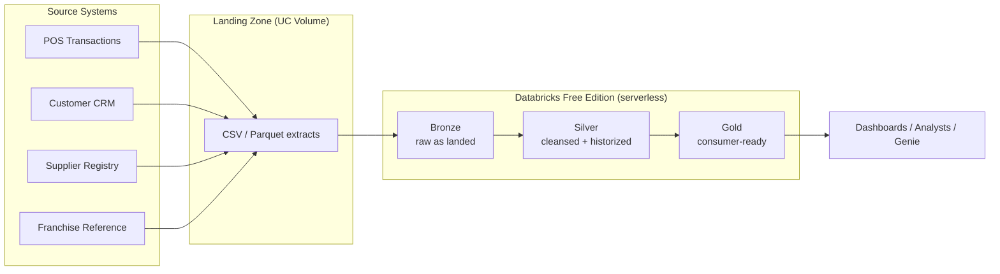

# 01 · Use Case Definition and Scope

| | |
|---|---|
| **Phase** | 1 – Discovery & Scoping |
| **Lesson** | Lecture – Use Case Definition and Scope |
| **Status** | DRAFT – pending customer sign-off |
| **Planning only** | No platform code is built in this phase |

> Items marked **(TBC)** are provisional and are confirmed in later Discovery lessons (profiling, governance, ingestion/historization decisions).

---

## 1. Engagement context

Stand up the **first production lakehouse for Bakehouse**, a global cookie franchise. Source extracts land as files in a landing zone, and one medallion pipeline turns them into governed analytics for franchise operations.

### Environment assumptions and constraints

| Item | Decision |
|---|---|
| Platform | Databricks **Free Edition**, serverless compute only |
| Landing zone | **Unity Catalog Volume**, standing in for S3/ADLS/GCS (no custom cloud bucket in Free Edition) |
| Source data | `samples.bakehouse` tables, exported to files and landed in the Volume |
| Environments | Single workspace. Dev/prod separation by catalog or schema (TBC) |
| Streaming (Kafka) | Not available, so file-based sources only |
| Compute limits | Daily serverless quota and low job concurrency, so keep the design lean |
| Documentation language | English |

> [!NOTE]
> Free Edition limits are recorded from prior knowledge. Verify them in the actual workspace (is `samples` visible, what is the quota) before kickoff.

---

## 2. Scope: one pipeline, bounded tables

| Constraint | Rule | This engagement |
|---|---|---|
| Pipeline count | Exactly one Bronze/Silver/Gold pipeline | **1** |
| Tables per layer | 10 or fewer per layer | Bronze ~4 · Silver ~4 · Gold ~3 **(TBC)** |
| Raw sources | Confirmed and reachable | 3 sources + 1 reference (see §3) |
| Consumers | Named personas with named outputs | Defined after data profiling **(TBC)** |

### In scope
- One medallion pipeline: Bronze → Silver → Gold.
- Sources: POS transactions, customer CRM, supplier registry, franchise reference.
- Batch file ingestion from a UC Volume.
- Historization of selected dimensions (strategy decided in a later lesson).
- Unity Catalog registration with owners, comments and tags.
- Data validation checks, a scheduled run, a runbook and per-persona guides.

### Out of scope (backlog for a follow-on phase)
| Item | Reason |
|---|---|
| `media_customer_reviews` and `media_gold_reviews_chunked` (unstructured and text data) | Extra source family that would increase validation and documentation effort |
| Streaming or Kafka ingestion | Not available in Free Edition and not needed for the first build |
| Multi-workspace promotion (dev → prod) | Single-workspace limit |
| Additional pipelines or domains | Scope discipline: prove the pattern first |

> [!WARNING]
> Scope creep is the primary failure mode. Anything new requested mid-build goes to the backlog and is not absorbed.

---

## 3. Raw sources

Source tables come from `samples.bakehouse`. They are exported to files and landed in a Volume to simulate extract delivery. Attributes marked **(TBC)** are confirmed during profiling.

| # | Course source | Bakehouse table | Mechanism | Location type | Cadence | Access confirmed | Schema-change contact |
|---|---|---|---|---|---|---|---|
| 1 | POS Transactions | `sales_transactions` | CSV/Parquet extract to Volume | UC Volume | Simulated batch drops (TBC) | ☐ Volume read/write validated | Simulated: POS platform team |
| 2 | Customer CRM | `sales_customers` | CSV/Parquet extract to Volume | UC Volume | Simulated batch drops (TBC) | ☐ | Simulated: CRM team |
| 3 | Supplier Registry | `sales_suppliers` | CSV/Parquet extract to Volume | UC Volume | Simulated batch drops (TBC) | ☐ | Simulated: Procurement |
| 4 | Franchise reference | `sales_franchises` | CSV/Parquet extract to Volume | UC Volume | Simulated batch drops (TBC) | ☐ | Simulated: Franchise ops |

Source owners and contacts are role-play values, since this is a training engagement.

---

## 4. Consumers

Named personas and outputs are **(TBC)** after data profiling.

| Persona (working hypothesis) | Likely output |
|---|---|
| Franchise operations manager | Sales performance by franchise |
| BI analyst | Curated sales and customer views |
| Procurement analyst | Supplier and ingredient insights |

---

## 5. Definition of done

Each criterion is written as a test, meaning something you can run. Detailed test queries are written in later phases.

| # | Criterion | Evidence (how it is tested) | Status |
|---|---|---|---|
| D1 | **Functional pipeline** | A pipeline run populates Bronze, Silver and Gold end to end, and a scheduled Job runs it successfully | ☐ |
| D2 | **Data validation** | Documented checks pass: row counts reconcile, keys are unique, time ranges are as expected, business rules hold | ☐ |
| D3 | **Unity Catalog schemas** | A query against `information_schema` shows every table and view registered with an owner, comment and tags | ☐ |
| D4 | **Documentation** | Scoping doc, runbook and per-persona user guides exist and are delivered | ☐ |
| D5 | **Scope budget respected** | Exactly 1 pipeline, and a table count of 10 or fewer per layer (verifiable by query) | ☐ |

D5 is an extra criterion I added to enforce the scope rule. Drop it if you prefer the four course criteria only.

---

## 6. Why tight scoping reduces delivery risk

- It proves the pattern end to end before it is scaled.
- Every added source, table or consumer multiplies validation and documentation effort.
- Fewer than 10 tables per layer keeps validation, documentation and handover manageable.
- Named consumers prevent a "build it and they will come" build.
- A confirmed source list removes speculative inputs and late surprises.

---

## 7. Open items for the next Discovery lessons

- [ ] Profile workloads and source data (volumes, keys, quality, time ranges), then confirm the table budget.
- [ ] Capture governance constraints (naming, ownership, tags, access model).
- [ ] Decide ingestion mode (batch vs incremental/Auto Loader).
- [ ] Decide historization strategy (SCD1 vs SCD2, per entity).
- [ ] Name the consumer personas and their outputs.
- [ ] Verify Free Edition limits and `samples.bakehouse` access.

## References
- [Medallion architecture](https://docs.databricks.com/aws/en/lakehouse/medallion)
- [What is a data lakehouse?](https://docs.databricks.com/aws/en/lakehouse/)
- [Unity Catalog overview](https://docs.databricks.com/aws/en/data-governance/unity-catalog/)
