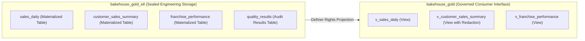

# 01 · Gold Layer Design, Presentation Architecture, and Security Controls

| | |
|---|---|
| **Phase** | 5 – Develop Gold Layer |
| **Status** | APPROVED – Under Implementation |
| **Platform** | Databricks Serverless, Lakeflow Spark Declarative Pipelines, Unity Catalog |
| **Traces to** | [scoping_document.md](../01_discovery_scoping/scoping_document.md), [03_governance_constraints.md](../01_discovery_scoping/03_governance_constraints.md), [02_data_design_keys_time.md](../02_foundation_kickoff/02_data_design_keys_time.md) |

---

## 1. The Two-Schema Architecture (`gold_etl` vs `gold`)

In accordance with *Lecture - Gold Schema and View Strategy*, the Gold layer is structured across two schemas to separate engineering lifecycle from consumer stability:

| Schema | Purpose | Permitted Objects | Group Access |
|---|---|---|---|
| `${catalog}.gold_etl` | Internal engineering storage, aggregation, and verification | Delta Materialized Tables, working tables, `quality_results` audit table | `data-engineers` (Owner). **Zero grants to consumers, ever.** |
| `${catalog}.gold` | Governed consumer presentation interface | Views projecting `gold_etl` tables with explicit column lists | `data-engineers` (Owner), `data-consumers` (`USE SCHEMA`, `SELECT`), `pii-readers` (`SELECT`) |

### Why This Separation Protects the Lakehouse
1. **Insulated Refactoring:** If the physical storage of `sales_daily` is restructured, repartitioned, or converted to a different clustering scheme in 6 months, engineering updates the table and re-points `v_sales_daily`. Consumers experience zero breaking changes.
2. **Definer Security:** Unity Catalog executes views using the view owner's rights on underlying tables. Consumers query `v_sales_daily` without requiring (or having) read access to the underlying `gold_etl` tables.
3. **Sealed by Absence of Grants:** In Unity Catalog, no grant means no access. `gold_etl` is permanently sealed by never granting on it.

---

## 2. Views as Stable Contracts

In accordance with *Lecture - Quality Rules and Query Optimization*:

1. **Explicit Column Enumeration:** `SELECT *` is strictly prohibited. Every view explicitly enumerates column names with deliberate aliases to prevent accidental schema leakage.
2. **Documented Meaning:** Every view and column carries descriptive comments registered in Unity Catalog `information_schema`.
3. **Pushdown-Friendly:** Views expose physical clustering columns (`business_date_local`, `franchise_id`, `customer_id`) directly to ensure queries skip files effectively without function-wrapping anti-patterns.
4. **Local Business Dates:** Event time (`transaction_ts` in UTC) is converted to each franchise's local business operating day (`business_date_local`) using its IANA time zone.

---

## 3. Business Rule Quality Checks (Four Rule Families)

Gold refreshes are audited by automated business rules before and during consumer consumption:

| Rule Family | Rule Name | Business Invariant | Enforcement Mechanism |
|---|---|---|---|
| **Counts** | `transaction_count_reconciliation` | Gold total `transaction_count` == Silver distinct `transaction_id` count (no lost or duplicated sales) | SQL check logged to `quality_results` |
| **Sums** | `revenue_non_negative_and_reconciled` | `MIN(gross_sales) >= 0` AND Gold `SUM(gross_sales)` == Silver `SUM(total_price)` | Pipeline Expectation + SQL check |
| **Distinct Growth** | `franchise_cardinality_integrity` | Active franchise count in Gold <= Total registered franchises in Silver | SQL check logged to `quality_results` |
| **Date Bounds** | `local_business_date_boundaries` | `MIN(date) >= '2024-05-01'` AND `MAX(date) <= CURRENT_DATE()` | Pipeline Expectation + SQL check |

All checks write a formal execution record to `${catalog}.gold_etl.quality_results` containing `run_timestamp`, `rule_family`, `rule_name`, `observed_value`, `expected_condition`, and `status` (`PASS`/`FAIL`).

---

## 4. Role-Based Access Control and PII Redaction

In accordance with *Lecture - Gold Security Controls*:

### 4.1 Group Privilege Matrix
| Principal (Group) | Catalog Privilege | `gold_etl` Privilege | `gold` Privilege | Specific View Rights |
|---|---|---|---|---|
| `data-engineers` | `ALL PRIVILEGES` | `OWNER` | `OWNER` | Full control on all objects |
| `data-consumers` | `USE CATALOG` | **NONE** | `USE SCHEMA` | `SELECT` on all `v_*` views |
| `pii-readers` | `USE CATALOG` | **NONE** | `USE SCHEMA` | `SELECT` on `v_customer_sales_summary` (unmasked) |

### 4.2 Dynamic PII Redaction
In `v_customer_sales_summary`, customer personal data is dynamically masked at the boundary using `is_account_group_member('pii-readers')`:
- **Email:** `john.doe@example.com` $\to$ `j***@example.com`
- **Phone:** `555-0199` $\to$ `***-***-0199`
- **Name:** `John Doe` $\to$ `J*** D***`
- Non-restricted analytical dimensions (spend, frequency, location) remain unmasked for business aggregation.

---

## 5. Acceptance Criteria (Gate G5)

| Test ID | Assertion Description | Target |
|---|---|---|
| **G-T1** | Two-Schema Boundary | `gold_etl` contains tables; `gold` contains views |
| **G-T2** | View Contract Discipline | 0 occurrences of `SELECT *` across all Gold view definitions |
| **G-T3** | Metadata Completeness | Comments registered for all views in `information_schema` |
| **G-T4** | Business Quality Rule Verification | 100% `PASS` across Counts, Sums, Growth, and Bounds in `quality_results` |
| **G-T5** | Financial & Count Reconciliation | Gold sales revenue and count match Silver exactly |
| **SEC-T1** | Sealed Schema Enforcement | 0 privileges granted to `data-consumers` on `gold_etl` |
| **SEC-T2** | Consumer View Grants | `data-consumers` holds `SELECT` on all `gold` views |
| **SEC-T3** | Dynamic PII Redaction | Restricted columns masked for general consumers; unmasked for `pii-readers` |
| **PUSH-T1** | Predicate Pushdown Verification | Filter on `business_date_local` and `franchise_id` pushes into scan node without function-wrapping |
