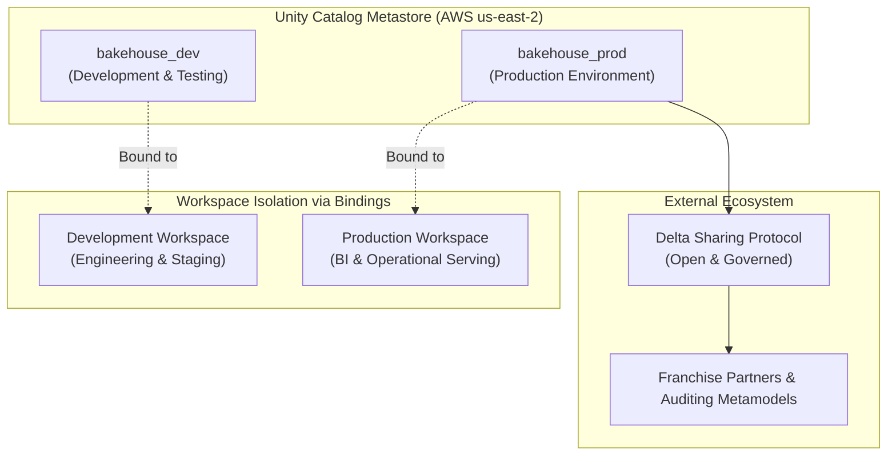
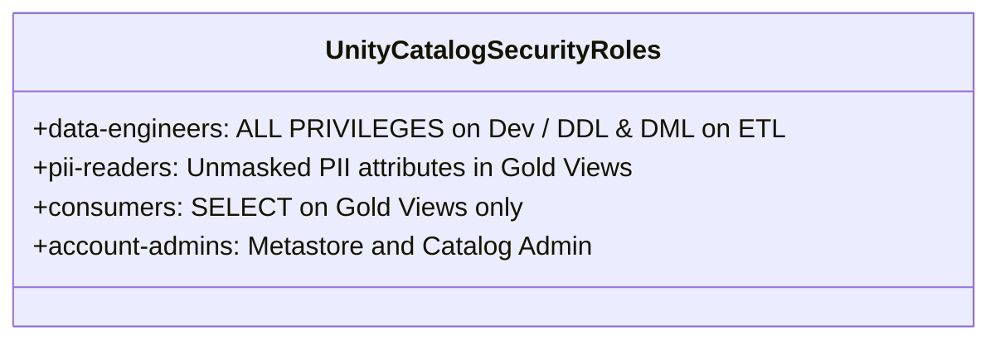

# Governance Enforcement at Scale – Bakehouse Lakehouse

| | |
|---|---|
| **Platform** | Unity Catalog (Metastore `metastore_aws_us_east_2`) |
| **Cloud Region** | AWS `us-east-2` (US East - Ohio) |
| **Phase** | Phase 6 – Optimization, Governance & Close |
| **Status** | COMPLETE |
| **Author** | Antigravity (Data Governance & Security Lead) |
| **Traceability** | Aligns with [scoping_document.md](../01_discovery_scoping/scoping_document.md) §4, [03_governance_guardrails.md](../02_foundation_kickoff/03_governance_guardrails.md) |

---

## 1. Regional Metastore Architecture

Unity Catalog establishes a **single metastore per cloud region**. The Bakehouse lakehouse metastore (`metastore_aws_us_east_2`) resides directly in AWS `us-east-2`, co-located with the Databricks workspace and landing S3 storage buckets.



### Key Principles of Regional Governance:
1. **Catalogs as the Boundary of Isolation:**
   - Rather than creating multiple regional metastores (which fragments lineage and access control), environments are partitioned into dedicated Unity Catalog catalogs: `bakehouse_dev` and `bakehouse_prod`.
2. **Zero Egress Latency:**
   - By anchoring the metastore, serverless compute, and cloud storage in the identical AWS region (`us-east-2`), cross-region egress charges and transfer latencies are reduced to zero.

---

## 2. Workspace-Catalog Bindings

In standard Unity Catalog deployments, every catalog in a metastore is visible by default to all workspaces attached to that metastore. To prevent catastrophic mistakes (e.g., an engineer running an experimental ETL script against production tables):

### Workspace-Catalog Binding Matrix

| Catalog | Bound Workspace | Access Mode | Isolation Guarantee |
|---|---|---|---|
| `bakehouse_dev` | Dev Workspace (`dbc-654c8244-a596`) | Read / Write (`ALL PRIVILEGES` to `data-engineers`) | Engineers cannot accidentally touch production data during exploratory coding or pipeline development |
| `bakehouse_prod` | Prod Workspace (or prod runner context) | Read / Write to CI/CD Service Principal only | Consumer BI tools and dashboards query prod views with read-only grants |
| `system` | All Workspaces | Read-only (`information_schema`, `billing`, `audit`) | Centralized observability across all environments |

---

## 3. Group Ownership Across Environments

Individual user accounts must **never** own securable objects in Unity Catalog. Individual ownership creates fragile permissions, breaks when team members transition, and introduces inconsistent audit logs.

### Standardized Security Roles



| Security Group | Role & Responsibilities | `bakehouse_dev` Privileges | `bakehouse_prod` Privileges |
|---|---|---|---|
| `data-engineers` | Pipeline development, schema migrations, and table maintenance | Owner of `landing`, `bronze`, `silver`, `gold_etl` | Deployment executed via CI/CD Service Principal; emergency break-glass only |
| `pii-readers` | Executive compliance and HR auditing | Receives unmasked customer email/phone in Gold view | Receives unmasked customer email/phone in Gold view |
| `consumers` | Franchise managers, operations analysts, BI tools | `SELECT` on `gold.v_*` views only | `SELECT` on `gold.v_*` views only (zero access to `gold_etl`, `silver`, `bronze`) |

### Identity Consistency Rule
The exact same group names (`data-engineers`, `pii-readers`, `consumers`) exist in the identity provider (IdP) and Unity Catalog account console. When promoting pipelines and code from `dev` to `prod` via Declarative Automation Bundles (DABs), **the security model never changes**—only the catalog prefix parameter changes from `bakehouse_dev` to `bakehouse_prod`.

---

## 4. Cross-Metastore Sharing via Delta Sharing

When external franchise operators, regional distribution centers, or external auditors require access to Bakehouse Gold datasets:

### The Delta Sharing Pattern vs Re-Registration Anti-Pattern

| Pattern | Architectural Approach | Governance Impact | Verdict |
|---|---|---|---|
| **Delta Sharing (Approved)** | The owning metastore publishes a Delta Share (`SHARE bakehouse_franchise_sales`) to external recipients. | Access is governed by the single owner; recipient queries read directly via secure, time-limited presigned URLs. No data duplication or dual commit coordinators. | **APPROVED** (Standard Lakehouse Pattern) |
| **Double-Registration (Prohibited)** | Registering the same external cloud storage path as a table in two different metastores. | **Corrupted Commit Log:** Two independent commit coordinators write to the same `_delta_log/`, causing silent file overwrites, unresolvable merge conflicts, and split governance. | **STRICTLY PROHIBITED** |

```sql
-- Pattern for Sharing across Metastores / External Partners:
CREATE SHARE IF NOT EXISTS bakehouse_partner_share
  COMMENT 'Governed Delta Share for external franchise operators';

ALTER SHARE bakehouse_partner_share 
  ADD TABLE bakehouse_prod.gold.v_sales_daily;
```

---

## 5. Audit & Compliance Observability

All access requests, data modifications, and privilege grants are captured automatically by Unity Catalog and accessible via system tables:
- **`system.access.audit`**: Real-time record of every `SELECT`, `UPDATE`, `GRANT`, and `REVOKE` across both dev and prod.
- **`system.information_schema`**: Automated inventory verifying that 100% of tables and views have assigned owners, comments, and tags.
- **Zero Drift Standard**: Any manual permission change directly in the UI is flagged as a drift incident; all permissions are defined in Git and applied via deployment scripts.
