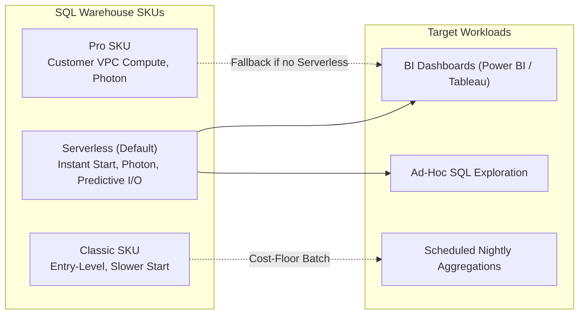
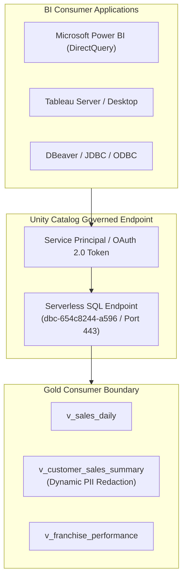
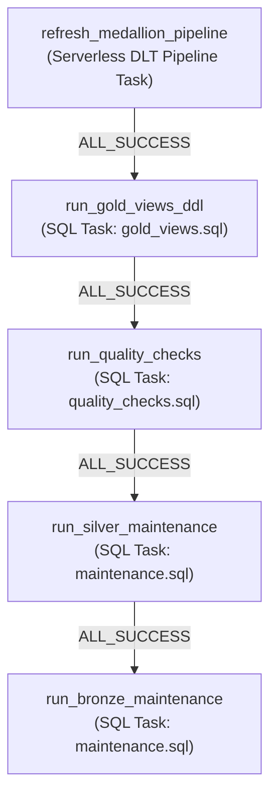

# Serving, BI Integration and Orchestration – Bakehouse Lakehouse

| | |
|---|---|
| **Platform** | Databricks SQL Warehouses, Lakeflow Jobs, DABs |
| **Warehouse ID** | `3c88b7bfb51daab1` (Serverless Starter Warehouse) |
| **Phase** | Phase 6 – Optimization, Governance & Close |
| **Status** | COMPLETE |
| **Author** | Antigravity (BI & Infrastructure Architect) |
| **Traceability** | Aligns with [scoping_document.md](../01_discovery_scoping/scoping_document.md) §1, [01_architecture_compute_planning.md](../02_foundation_kickoff/01_architecture_compute_planning.md) |

---

## 1. SQL Warehouse Sizing and SKUs

Databricks SQL Warehouses provide the query engine for BI dashboards, ad-hoc analytics, and scheduled reporting. Sizing and SKU selection balance latency against DBU consumption.



### Sizing and SKU Strategy Matrix

| Dimension | Strategy & Guidance | Implemented Value on Bakehouse |
|---|---|---|
| **Selected SKU** | **Serverless** (Instant startup in seconds, Photon engine, Intelligent Workload Management) | `Serverless Starter Warehouse` |
| **Warehouse Sizing** | T-shirt sizes. Scale **UP** (e.g., 2X-Small $\rightarrow$ Small) for complex queries; scale **OUT** (more clusters) for concurrency | `2X-Small` (Sufficient for sub-50ms scans on Gold views) |
| **Auto-Stop Policy** | Aggressive idle shutdown to eliminate costs when analysts are inactive | **10 Minutes** auto-stop configured |
| **Scaling Policy** | Min clusters: 1, Max clusters: 1 (Dev) / 2 (Prod peak) | Autoscaling cluster count on queue pressure |

---

## 2. BI Integration on Unity Catalog Endpoints

BI applications (Power BI, Tableau, ThoughtSpot, Looker) connect directly to the Serverless SQL Warehouse via Unity Catalog endpoints. 



### Connection Configuration Parameters

| Parameter | Connection String Value | Verification / Best Practice |
|---|---|---|
| **Server Hostname** | `dbc-654c8244-a596.cloud.databricks.com` | Verified reachable over TLS 443 |
| **Port** | `443` | Standard HTTPS/TLS port |
| **Protocol / Transport** | HTTP / HTTPS | Direct Databricks Connector |
| **HTTP Path** | `/sql/1.0/warehouses/3c88b7bfb51daab1` | Points to dedicated Serverless Starter Warehouse |
| **Default Catalog** | `bakehouse_dev` (or `bakehouse_prod`) | Direct routing to target environment |
| **Default Schema** | `gold` | Exposes consumer views only (`v_*`) |
| **Authentication** | Service Principal OAuth M2M (Prod) / User OAuth (Dev) | Service principal eliminates personal user dependencies |

### Cloud Fetch Optimization
- **Mechanics:** When BI dashboards extract large datasets (e.g., annual transactions extract), Databricks **Cloud Fetch** bypasses the driver node and streams encrypted Arrow data chunks in parallel directly from cloud storage presigned URLs to the client.
- **Validation:** Drivers must support Cloud Fetch (ODBC/JDBC $\ge \text{v2.6.22}$). Egress firewall rules allow access to regional S3 presigned endpoints (`s3.us-east-2.amazonaws.com`).

---

## 3. Pipeline Orchestration with Lakeflow Jobs

The entire Medallion journey (Bronze $\rightarrow$ Silver $\rightarrow$ Gold ETL $\rightarrow$ Consumer Views $\rightarrow$ Quality Checks $\rightarrow$ Maintenance) is orchestrated as a single multi-task DAG in Lakeflow Jobs.

### Master Orchestration DAG Architecture



### Master Job Settings (`bundle/resources/bakehouse_master_orchestration.job.yml`)
- **Job ID:** `250613608242315`
- **Name:** `[${bundle.target}] Bakehouse Master Lakehouse Orchestrator`
- **Sequential Free-Edition Guardrail:** Because Serverless compute capacity in the Free Edition permits 1 active serverless unit at a time, the pipeline runs first; upon pipeline completion, the warehouse executes the downstream SQL tasks sequentially.
- **Failure Halting:** Any task failure (`T1`, `T2`, or `T3`) immediately halts downstream execution, preventing corrupt views or unverified data from being exposed to consumers.
- **Schedule:** `0 0 6 * * ?` (Daily at 06:00 UTC, paused by default in dev).

---

## 4. CI/CD with Declarative Automation Bundles (DABs)

The entire infrastructure—pipelines, jobs, schemas, and queries—is defined as declarative code in `bundle/databricks.yml`.

### Deployment Lifecycle

| Action | Command | Outcome |
|---|---|---|
| **Syntax & Dependency Validation** | `databricks bundle validate --profile dev` | Validates YAML syntax, resource cross-references, and variables without making changes |
| **Continuous Integration Deployment** | `databricks bundle deploy --profile dev` | Deploys files to workspace `/Workspace/Users/.../.bundle/` and updates resources idempotently |
| **Ad-Hoc DAG Run** | `databricks bundle run bakehouse_master_orchestration --profile dev` | Executes the complete multi-task orchestrator |
| **Deterministic Rollback** | `git checkout <commit_hash> && databricks bundle deploy --profile dev` | Restores prior pipeline and job configurations in a single command |

### Pipeline as Cattle Principle
If all jobs, pipelines, and schema definitions in the Databricks workspace were deleted, the entire platform can be recreated cleanly and identically from scratch within minutes using:
```bash
git clone <repo_url>
cd lakehouse_build/bundle
databricks bundle deploy --target prod
```
