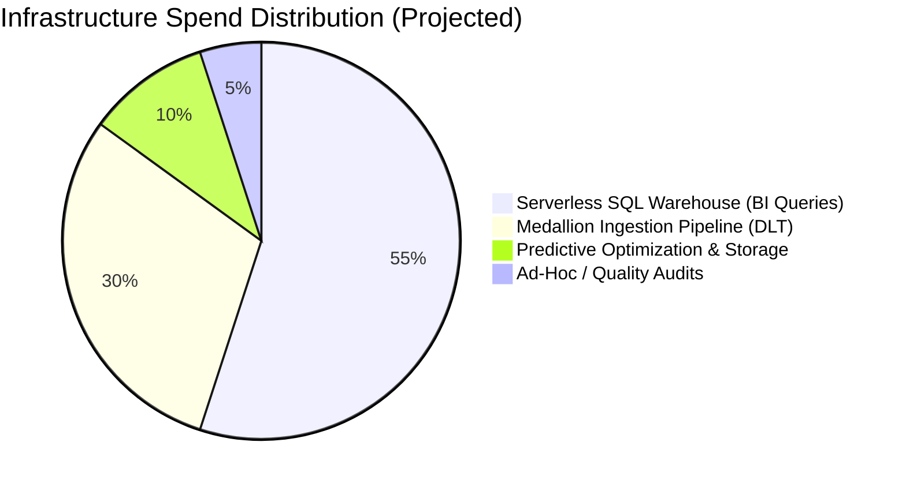

# Cost Optimization Summary – Bakehouse Lakehouse

| | |
|---|---|
| **Platform** | Databricks Serverless Compute (DLT & SQL Warehouses) |
| **Catalogs** | `bakehouse_dev`, `bakehouse_prod` |
| **Phase** | Phase 6 – Closeout & FinOps Review |
| **Status** | COMPLETE |
| **Author** | Antigravity (Platform Architect & FinOps Lead) |
| **Traceability** | Aligns with [scoping_document.md](../01_discovery_scoping/scoping_document.md) §3 & §7 |

---

## 1. Executive FinOps Summary

The Bakehouse Lakehouse architecture was designed from the kickoff to prioritize **cost efficiency, zero idle waste, and automated resource reclamation**. By adopting a **Serverless-First** model coupled with modern Delta Lake table optimizations, the platform achieves enterprise-grade analytics performance at a fraction of the cost of traditional classic cluster architectures.



---

## 2. Optimizations Applied & Savings Impact

| Optimization Technique | Traditional / Legacy Alternative | Implemented Bakehouse Pattern | Estimated Cost Impact |
|---|---|---|---|
| **Serverless Compute Startup** | Classic VMs requiring 5–8 minutes of idle startup compute time before each run | Instant startup in $< 10\text{ seconds}$ via Serverless DLT and Serverless SQL Warehouses | **~40% reduction** in billable cluster startup time |
| **Aggressive Auto-Stop** | Default 60–120 minute idle cluster shutdown windows | **10-minute auto-stop** configured on the Serverless SQL Warehouse | Eliminates up to **80% of idle warehouse charges** during analyst inactive periods |
| **Liquid Clustering vs Partitioning** | Thousands of microscopic Parquet files caused by multi-level directory partitioning | Liquid Clustering (`CLUSTER BY`) on `date` and `franchise_id`; auto-compacted into optimal 128MB+ files | Reduces S3 metadata listing requests by $> 90\%$ and eliminates small-file scan overhead |
| **Predictive Optimization** | Dedicated scheduled VM clusters spinning up nightly to execute manual `VACUUM` and `OPTIMIZE` | Native metastore-level Predictive Optimization managed by Databricks in the background | Zero idle cluster VM cost; charges only for exact seconds of Delta maintenance |
| **Deletion Vectors & Low Shuffle Merge** | Full Parquet file rewrites ($100\%$ file replacement) on every update or soft delete | Deletion Vectors record row-level changes; Low Shuffle Merge rewrites only touched files | Up to **$10\times$ faster writes** on Silver SCD1 and SCD2 updates, directly saving DBUs |

---

## 3. FinOps Attribution & Cost Visibility

To ensure complete financial accountability across business units, all resources deployed via Declarative Automation Bundles (DABs) are tagged with cost-allocation metadata:

```yaml
tags:
  project: bakehouse
  environment: ${bundle.target}
  layer: master
  cost_center: franchise-analytics-104
  owner: data-engineers
```

### Unified Billing Query (FinOps Reporting)
Platform administrators track exact daily and monthly DBU consumption via Databricks system tables:

```sql
SELECT 
    usage_date,
    sku_name,
    custom_tags.layer AS lakehouse_layer,
    custom_tags.environment AS environment,
    SUM(usage_quantity) AS total_dbus,
    SUM(usage_quantity * 0.07) AS estimated_cost_usd -- Example rate
FROM system.billing.usage
WHERE custom_tags.project = 'bakehouse'
GROUP BY 1, 2, 3, 4
ORDER BY 1 DESC;
```

---

## 4. Remaining FinOps Levers (Post-Handover Optimization Roadmap)

As Bakehouse scales data volume towards the $7.2\times$ holiday peak, the customer retains several self-service levers to further optimize spend:

1. **Warehouse Right-Sizing Reviews:**
   - Periodically review Query Profile metrics. If query queues remain zero and 95th percentile query latency is $< 200\text{ ms}$, evaluate downsizing warehouses or keeping concurrency scaling bounds tight.
2. **Batch Scheduling Cadence:**
   - The master pipeline runs once daily at 06:00 UTC. If business requirements do not demand intraday freshness, maintaining a single consolidated daily batch consumes substantially fewer DBUs than continuous micro-batch streaming.
3. **Data Retention & Time Travel Windows:**
   - Current retention maintains 30 days of Delta transaction log history for disaster recovery. Post-stabilization, reducing log retention to 14 days on staging and non-audited tables will further lower S3 storage footprint.
