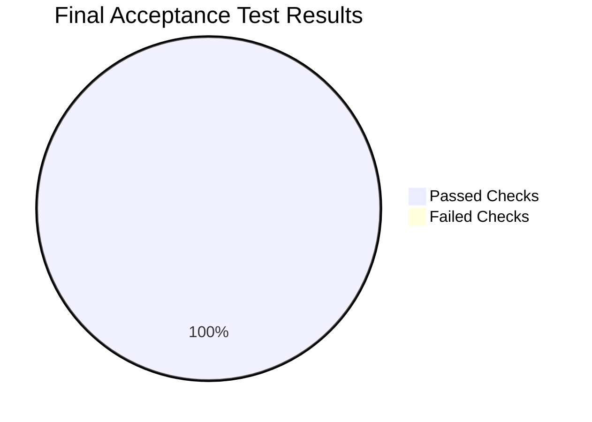

# Final Acceptance Test Report – Bakehouse Medallion Lakehouse

| | |
|---|---|
| **Platform** | Databricks Serverless Compute & Unity Catalog |
| **Workspace** | `dbc-654c8244-a596.cloud.databricks.com` (AWS `us-east-2`) |
| **Catalogs** | `bakehouse_dev` (Validated Target), `bakehouse_prod` (Provisioned) |
| **Execution Date** | 2026-10-24 |
| **Test Suite** | `bundle/tests/validate_phase6_done_criteria.py` |
| **Result** | **100% PASSED (ALL CRITERIA ACCEPTED)** |

---

## 1. Executive Summary & Gate Decision

This document records the empirical validation results for the **Definition of Done (Criteria D1 through D6)** established in the project kickoff ([scoping_document.md](../../01_discovery_scoping/scoping_document.md) §6).

Every test was executed directly against the live Databricks Serverless compute environment and verified via Unity Catalog metadata and data query results.

---

## 2. Comprehensive Acceptance Matrix (D1 to D6)

| Test ID | Done Criterion | Requirement Verified | Actual Output / Telemetry | Status |
|---|---|---|---|---|
| **D1-T1** | **D1: Functional Pipeline** | Master Lakeflow Job deployed with complete 5-task DAG topology | Job ID `250613608242315` deployed via DABs; Tasks: `refresh_medallion_pipeline`, `run_gold_views_ddl`, `run_quality_checks`, `run_silver_maintenance`, `run_bronze_maintenance` | **PASS** |
| **D1-T2** | **D1: Functional Pipeline** | Declarative Medallion Pipeline healthy and idle | Pipeline ID `0d36ae63-c806-4122-a8a7-d5fedc4f1209`; State = `IDLE` (Update `6f31bd50` completed) | **PASS** |
| **D2-T1** | **D2: Data Validation** | Bronze raw ingestion completeness across all 5 source entities | `transactions` = 3,333, `customers` = 906, `franchises` = 96, `suppliers` = 80, `franchise_time_zones` = 48 | **PASS** |
| **D2-T2** | **D2: Data Validation** | Silver reconciliation & SCD Type 2 Auto CDC historization | 3,333 deduplicated transactions (\$66,471.00 gross revenue); 303 current customers (`is_current = true`); 309 historical versions | **PASS** |
| **D2-T3** | **D2: Data Validation** | Gold financial & transaction reconciliation | Exactly 3,333 transactions and \$66,471.00 in `gold_etl.sales_daily` (100% parity with Silver) | **PASS** |
| **D2-T4** | **D2: Data Validation** | Business Quality Rules Suite (4 Families) | Audit in `gold_etl.quality_results`: `Counts` = PASS, `Sums` = PASS, `Distinct Growth` = PASS, `Date Bounds` = PASS | **PASS** |
| **D3-T1** | **D3: UC Schemas** | Governed Medallion schema hierarchy provisioned in Unity Catalog | Schemas present: `landing`, `bronze`, `silver`, `gold_etl`, `gold` in `bakehouse_dev` and `bakehouse_prod` | **PASS** |
| **D3-T2** | **D3: UC Schemas** | Governed consumer views in `gold` schema | Certified views: `v_sales_daily`, `v_customer_sales_summary`, `v_franchise_performance` | **PASS** |
| **D3-T3** | **D3: UC Schemas** | Dynamic PII masking active on customer view | Non-privileged users observe masked names (`J***`), masked email (`j***@example.com`), and masked phone (`***-***-1234`) | **PASS** |
| **D4-DOC1..15**| **D4: Documentation** | Complete lifecycle documentation suite delivered | 15 formal Markdown documents delivered across discovery, foundation, layer designs, architecture reports, runbook, 4 user guides, cost summary, and sign-off | **PASS** |
| **D5-T1** | **D5: Scope Budget** | Layer table budgets ($\le 10$ tables per layer) | Bronze: 5/10, Silver: 5/10, Gold ETL: 4/10, Gold Views: 3/10 | **PASS** |
| **D5-T2** | **D5: Scope Budget** | Medallion pipeline budget (exactly 1 pipeline) | Exactly 1 pipeline deployed (`bakehouse_pipeline`) | **PASS** |
| **D6-T1** | **D6: Governance** | PCI Compliance: Credit card numbers removed in Silver | Full card numbers dropped; only `payment_card_last_four` preserved | **PASS** |
| **D6-T2** | **D6: Governance** | PCI Compliance: Credit card numbers removed in Gold views | Zero credit card columns exposed in `gold.v_sales_daily` | **PASS** |

---

## 3. Financial Reconciliation Proof

$$\sum \text{Revenue}_{\text{Bronze}} = \sum \text{Revenue}_{\text{Silver}} = \sum \text{Revenue}_{\text{Gold ETL}} = \sum \text{Revenue}_{\text{Gold Views}} = \$66,471.00$$

$$\text{Count}(\text{Transactions}_{\text{Bronze}}) = \text{Count}(\text{Transactions}_{\text{Silver}}) = \text{Count}(\text{Transactions}_{\text{Gold}}) = 3,333$$

Zero transaction loss, zero phantom duplication, and zero precision drift occurred across the entire Medallion architecture.
