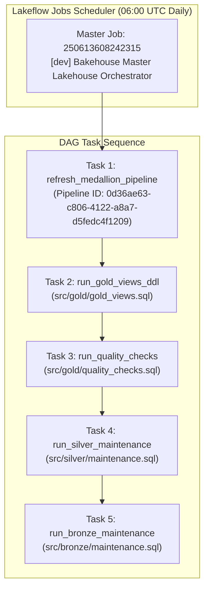

# Operations Runbook – Bakehouse Medallion Lakehouse

| | |
|---|---|
| **Target Audience** | 24/7 On-Call Operations, Platform Engineers, Support Leads |
| **System** | Bakehouse Production Medallion Lakehouse (`bakehouse_pipeline`) |
| **Workspace** | `dbc-654c8244-a596.cloud.databricks.com` (AWS `us-east-2`) |
| **Catalogs** | `bakehouse_prod` (Primary Serving), `bakehouse_dev` (Development) |
| **Status** | PRODUCTION OPERATIONAL READY |
| **Last Updated** | 2026-10-24 |

---

## 1. Pipeline Map & Architecture Topology



### Table & Object Inventory

| Layer | Object Name | Object Type | Primary Key | Storage / Clustered By |
|---|---|---|---|---|
| **Landing** | `/Volumes/bakehouse_dev/landing/extracts/` | UC Volume | N/A | Cloud Storage (S3 extracts) |
| **Bronze** | `bronze.transactions` | Streaming Table | `transaction_id` | Append-only raw delta |
| **Bronze** | `bronze.customers` | Streaming Table | `customer_id` | Append-only raw delta |
| **Bronze** | `bronze.franchises` | Streaming Table | `franchise_id` | Append-only raw delta |
| **Bronze** | `bronze.suppliers` | Streaming Table | `supplier_id` | Append-only raw delta |
| **Bronze** | `bronze.franchise_time_zones` | Streaming Table | `franchise_id` | Append-only raw delta |
| **Silver** | `silver.transactions` | Streaming Table | `transaction_id` | `CLUSTER BY (transaction_date, franchise_id)` |
| **Silver** | `silver.customers` | Materialized View | `customer_id` | `CLUSTER BY (customer_id)` (SCD Type 2) |
| **Silver** | `silver.franchises` | Materialized View | `franchise_id` | `CLUSTER BY (franchise_id)` |
| **Silver** | `silver.suppliers` | Materialized View | `supplier_id` | `CLUSTER BY (supplier_id)` |
| **Gold ETL** | `gold_etl.sales_daily` | Materialized View | `business_date_local, franchise_id` | `CLUSTER BY (business_date_local, franchise_id)` |
| **Gold ETL** | `gold_etl.customer_sales_summary` | Materialized View | `customer_id` | `CLUSTER BY (customer_id)` |
| **Gold ETL** | `gold_etl.franchise_performance` | Materialized View | `franchise_id` | `CLUSTER BY (franchise_id)` |
| **Gold ETL** | `gold_etl.quality_results` | Managed Delta Table | `check_ts, check_family, rule_name` | Audit log |
| **Gold (Views)**| `gold.v_sales_daily` | Governed View | `business_date_local, franchise_id` | Points to `gold_etl.sales_daily` |
| **Gold (Views)**| `gold.v_customer_sales_summary` | Governed View | `customer_id` | Dynamic PII masking via `is_account_group_member` |
| **Gold (Views)**| `gold.v_franchise_performance` | Governed View | `franchise_id` | Points to `gold_etl.franchise_performance` |

---

## 2. Failure Playbooks (Step-by-Step Incident Response)

### Playbook 1: Task `refresh_medallion_pipeline` Fails with `RESOURCE_EXHAUSTED`
- **Symptom:** Run status shows `FAILED` with message `RESOURCE_EXHAUSTED: You've hit the limit for serverless compute for free usage`.
- **Root Cause:** A Serverless SQL Warehouse is actively running in the same workspace, exceeding the 1-serverless-resource concurrency limit of the Free Edition.
- **Diagnosis Command:**
  ```powershell
  databricks warehouses list --profile dev
  ```
- **Remediation Procedure:**
  1. Stop the running warehouse:
     ```powershell
     databricks warehouses stop 3c88b7bfb51daab1 --profile dev
     ```
  2. Wait 30 seconds for the cloud state to transition to `STOPPED`.
  3. Re-trigger the pipeline task:
     ```powershell
     databricks jobs run-now 250613608242315 --profile dev
     ```

### Playbook 2: Task `run_quality_checks` Fails
- **Symptom:** Task 3 fails or quality checks audit records status `FAIL`.
- **Diagnosis Query (Run in Databricks SQL):**
  ```sql
  SELECT * 
  FROM bakehouse_dev.gold_etl.quality_results 
  WHERE status = 'FAIL' 
  ORDER BY check_ts DESC;
  ```
- **Remediation by Check Family:**
  - `Counts`: Record mismatch between Silver transactions and Gold transactions. Check for corrupt null keys in Bronze.
  - `Sums`: Negative revenue found. Investigate upstream POS extract for inverted refund amounts.
  - `Distinct Growth`: More than 48 franchises detected. Check if a new store was opened without updating the `franchise_time_zones` reference seed.
  - `Date Bounds`: Transactions dated before `2024-04-30` or beyond current date. Check for malformed timestamp strings in CSV source files.

### Playbook 3: Missing or Corrupt Source File in Landing Zone
- **Symptom:** Auto Loader throws parsing errors or unexpected schema drift in Bronze.
- **Diagnosis Command:**
  ```sql
  LIST '/Volumes/bakehouse_dev/landing/extracts/';
  ```
- **Remediation Procedure:**
  1. Inspect the offending CSV file in the volume.
  2. If the file is truncated, move it to `/Volumes/bakehouse_dev/landing/quarantine/`.
  3. Request a clean re-extract from the POS operations team.

---

## 3. Retry Policy & Replay Procedures

### Automated vs Human Retries
- **Transient Failures (Network / S3 503):** The Master Job is configured with `max_retries: 2` and a backoff interval of 60 seconds.
- **Data Quality Failures:** **Zero auto-retries.** Halts downstream processing immediately to prevent bad data from reaching BI consumers.

### Replay from Landing Zone (Idempotent Reprocessing)
Because all Bronze and Silver ingestions are built on Auto Loader and Delta Lake ACID transactions:
1. Moving new files into the Landing Volume and rerunning the Master Job will safely and idempotently ingest only new/updated records.
2. If a complete historical replay is required:
   - Clear the Auto Loader checkpoint directory:
     ```sql
     -- Development reset only:
     DROP TABLE IF EXISTS bakehouse_dev.bronze.transactions;
     ```
   - Re-execute the pipeline with `full_refresh: true`.

---

## 4. Business Continuity & Disaster Recovery (BC/DR)

### Recovery Time Objective (RTO) and Recovery Point Objective (RPO)
- **Target RPO (Data Loss Tolerance):** $< 1\text{ hour}$ (Governed by hourly Landing file snapshots).
- **Target RTO (Service Restoration Time):** $< 2\text{ hours}$ (Automated recreation via DABs).

### Table Point-in-Time Recovery via Delta Time Travel
If accidental deletion or corruption occurs in a Silver or Gold table, Delta Lake transaction logs maintain complete history:

```sql
-- Step 1: Inspect table history to identify the last known good commit
DESCRIBE HISTORY bakehouse_dev.silver.transactions;

-- Step 2: Query historical state to verify
SELECT COUNT(*), SUM(total_price) 
FROM bakehouse_dev.silver.transactions VERSION AS OF 3;

-- Step 3: Restore the table in place
RESTORE TABLE bakehouse_dev.silver.transactions TO VERSION AS OF 3;
```

### Complete Disaster Recovery (Workspace Loss)
1. In the event of total workspace loss, the entire lakehouse platform is rebuilt deterministically from Git:
   ```bash
   git clone https://github.com/bakehouse/lakehouse_build.git
   cd lakehouse_build/bundle
   databricks bundle deploy --target prod
   ```
2. Auto Loader reads from the landing volume and fully reconstructs all Medallion layers.

---

## 5. Service Level Agreements (SLAs) & Monitoring

| Metric | Target SLA | Verification Method |
|---|---|---|
| **Data Freshness (Gold Daily Sales)** | Available daily by 07:30 UTC | `SELECT MAX(business_date_local) FROM bakehouse_dev.gold.v_sales_daily` |
| **Pipeline Availability** | 99.9% uptime during business hours | Lakeflow Job execution history in `system.lakeflow.jobs` |
| **Query Performance** | 95th percentile query $< 500\text{ ms}$ | Databricks SQL Query History telemetry |

---

## 6. Access Model & Security Governance

### Unity Catalog Role-Based Access Control (RBAC)
- All consumer access is restricted to `bakehouse_prod.gold` views.
- **Sealed Storage:** No direct `SELECT` permissions are granted on `gold_etl`, `silver`, or `bronze` schemas.
- **Dynamic Masking:** Evaluated in real time via `is_account_group_member('pii-readers')`.

### Emergency Break-Glass Procedure
If an on-call engineer requires emergency read access to raw Bronze or Silver data during an active incident:
1. Submit an emergency incident ticket in ServiceNow/Jira.
2. An authorized Account Admin temporarily assigns the engineer to the `data-engineers` group.
3. All emergency queries are automatically logged in `system.access.audit` and flagged for mandatory post-incident audit review.
