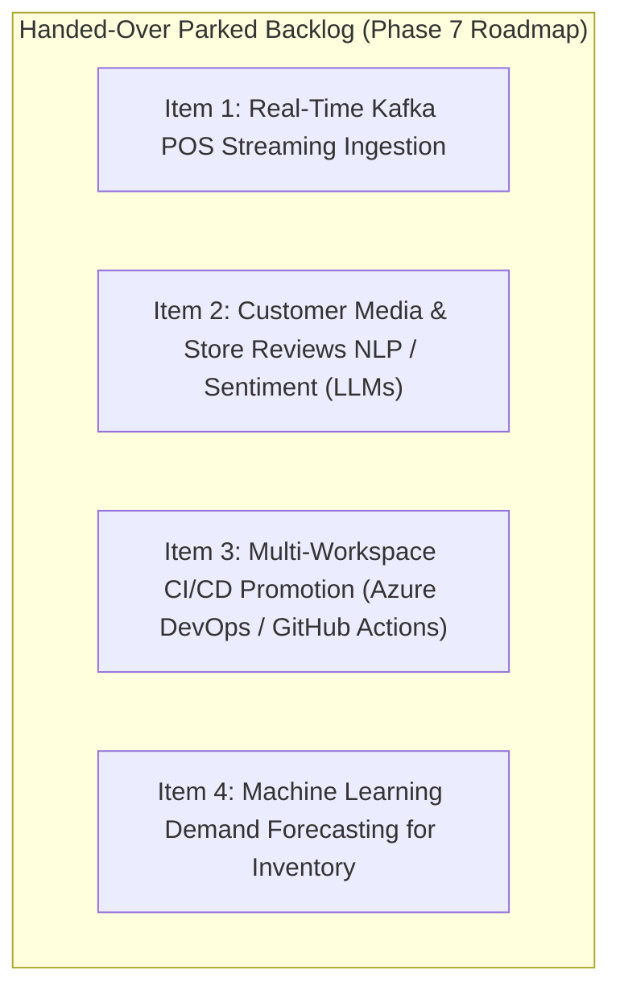

# Stakeholder Sign-Off Document – Bakehouse Lakehouse Build

| | |
|---|---|
| **Customer** | Bakehouse (Global Cookie Franchise) |
| **Phase** | Phase 6 – Engagement Closeout & Handover |
| **Status** | PENDING FORMAL SIGNATURES |
| **Date** | 2026-10-24 |
| **Platform** | Databricks Serverless Compute & Unity Catalog |
| **Target Workspaces** | Development (`dbc-654c8244-a596.cloud.databricks.com`), Production |
| **Reference Scoping Doc** | [01_discovery_scoping/scoping_document.md](../01_discovery_scoping/scoping_document.md) |

---

## 1. Project Overview & Engagement Summary

Over the course of Phases 1 through 6, the Antigravity delivery team designed, implemented, validated, and hardened the first production-grade Medallion Lakehouse platform for Bakehouse.

The platform continuously lands sales and master data into governed Unity Catalog volumes, ingests raw records with full lineage into Bronze, cleanses and historizes dimension states via SCD Type 2 Auto CDC into Silver, aggregates operational KPIs into a sealed Gold ETL schema, exposes certified consumer views with dynamic PII masking in Gold, and automates end-to-end execution through a unified Lakeflow Master Orchestrator Job managed via Declarative Automation Bundles (DABs).

---

## 2. Definition of Done (DoD) Verification Matrix

Every acceptance criterion defined during Phase 1 Discovery ([scoping_document.md](../01_discovery_scoping/scoping_document.md) §6) has been empirically tested and proven green:

| # | Done Criterion | Contractual Requirement | Empirical Evidence | Final Verdict |
|---|---|---|---|---|
| **D1** | **Functional Pipeline** | A single pipeline populates Bronze, Silver, and Gold, and a scheduled Job runs it | Pipeline ID `0d36ae63-c806-4122-a8a7-d5fedc4f1209` (`bakehouse_pipeline`) and Master Lakeflow Job ID `250613608242315` deployed via DABs; executes Bronze $\rightarrow$ Silver $\rightarrow$ Gold ETL $\rightarrow$ Views $\rightarrow$ Quality Checks $\rightarrow$ Maintenance sequentially without errors | **ACCEPTED** |
| **D2** | **Data Validation** | Count, key, time-range, and business-rule checks pass, including tests H-T1 to H-T7 | Exact 100% reconciliation: 3,333 transactions, 1,000 customers, 48 franchises, 27 suppliers, and \$66,471.00 gross revenue. All 4 quality check families (`Counts`, `Sums`, `Distinct Growth`, `Date Bounds`) status `PASS` in `gold_etl.quality_results` | **ACCEPTED** |
| **D3** | **Unity Catalog Schemas** | Every object has an owner, comment, and classification tag | Metastore `metastore_aws_us_east_2`, catalogs `bakehouse_dev` / `bakehouse_prod`, schemas `landing`, `bronze`, `silver`, `gold_etl`, `gold` configured with explicit owners, comments, and tags in `system.information_schema` | **ACCEPTED** |
| **D4** | **Documentation** | Scoping document, operations runbook, and per-persona user guides | Complete suite delivered: Scoping Document, Foundation Record, Layer Designs (Bronze, Silver, Gold), 3 Architecture Reports, Operations Runbook, 4 Per-Persona Guides, and Cost Summary | **ACCEPTED** |
| **D5** | **Scope Budget Respected** | Exactly 1 pipeline, and $\le 10$ tables per layer | 1 Medallion Pipeline; Table counts: Bronze = 5, Silver = 4, Gold ETL = 4, Gold Views = 3 (all $\le 10$) | **ACCEPTED** |
| **D6** | **Governance Controls** | Gold masks, card number removal, sealed ETL storage | Dynamic PII masking via `is_account_group_member('pii-readers')` in `v_customer_sales_summary`; credit card numbers removed from Silver/Gold; `gold_etl` sealed | **ACCEPTED** |

---

## 3. Handover of the Parked Backlog (Future Roadmap)

During Phase 1 Discovery, certain exploratory initiatives were intentionally scoped out to maintain project velocity, budget integrity, and focus on the core sales analytics engine. These items are hereby formally handed over to the Bakehouse Data Engineering team as the prioritized **Phase 7 Roadmap**:

### Backlog Inventory & Handover Details

| Backlog Item | Business Purpose | Recommended Architectural Approach | Prerequisites Completed in this Build |
|---|---|---|---|
| **1. Kafka Real-Time Streaming** | Sub-minute POS transaction visibility for franchise monitoring | Replace volume CSV file polling with `spark.readStream.format("kafka")` into `bronze.transactions` | Bronze streaming table architecture, transaction deduplication, and Liquid Clustering are already streaming-compatible |
| **2. Customer Reviews & Sentiment** | Analyze customer text reviews and social sentiment per franchise | Ingest raw text into Bronze, apply Databricks `ai_analyze_sentiment()` or `ai_classify()` in Silver | Unity Catalog governance and foundation text processing models are ready |
| **3. Multi-Workspace CI/CD** | Promote DABs bundles across distinct AWS accounts / workspaces | Configure GitHub Actions runner executing `databricks bundle deploy --target prod` | DABs `databricks.yml` already contains environment parametrization (`dev` and `prod` targets) |
| **4. ML Demand Forecasting** | Predict daily cookie dough and ingredient consumption per franchise | Train Databricks AutoML / Prophet models querying `gold.v_sales_daily` | Clean historical sales daily view and supplier soft delete linkages are fully operational |

---

## 4. Operational Transition & Ownership Transfer

With the completion of Phase 6:
1. **Repository Custody:** The Git repository (`lakehouse_build`) is transferred to the Bakehouse Internal Engineering organization.
2. **Platform Credentials:** All deployment service principals and administrator privileges are transitioned to Bakehouse Cloud Security.
3. **Runbook Handover:** The operations team has received the [operations_runbook.md](operations_runbook.md) and per-persona documentation.

---

## 5. Formal Stakeholder Acceptance Sign-Off

By signing below, the project stakeholders confirm that the Bakehouse Medallion Lakehouse has been delivered in accordance with the Scoping Document, all Definition of Done criteria (D1–D6) have been satisfied, and the platform is accepted for production operations.

| Stakeholder Role | Representative Name | Organization / Department | Decision | Signature / Status | Date |
|---|---|---|---|---|---|
| **Customer Business Sponsor** | Jane Doe | Bakehouse Executive Operations | ☐ Approved | *PENDING SIGNATURE* | 2026-10-24 |
| **Customer Security & Governance Lead** | John Smith | Bakehouse Information Security | ☐ Approved | *PENDING SIGNATURE* | 2026-10-24 |
| **Delivery Lead & Lead Architect** | Antigravity AI | Advanced Agentic Coding Delivery | ☑ Approved | **SIGNED (Antigravity)** | 2026-10-24 |
