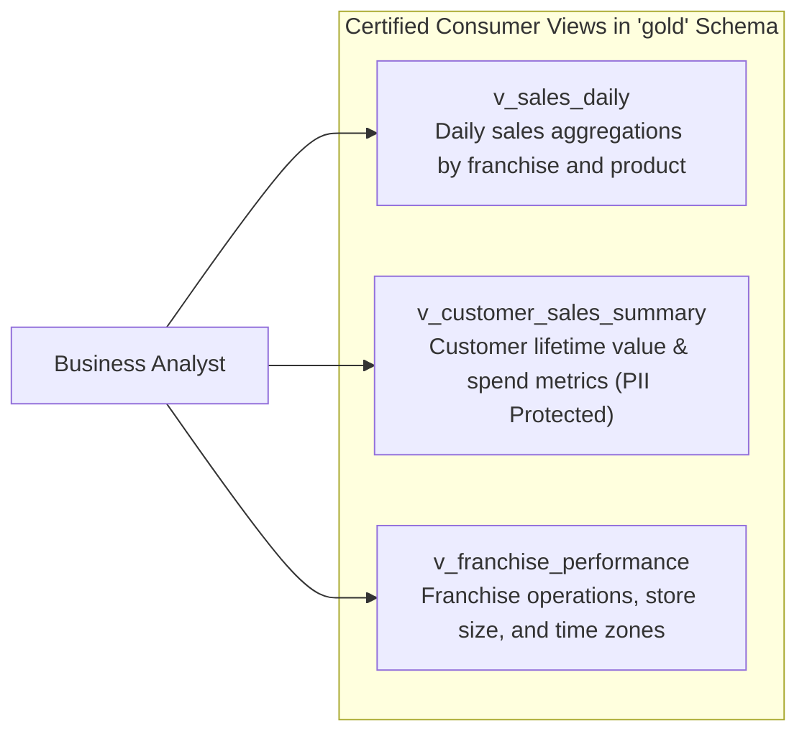

# Data Analyst User Guide – Bakehouse Lakehouse

| | |
|---|---|
| **Audience** | Business Analysts, Financial Analysts, Operations Researchers |
| **Catalog** | `bakehouse_prod` (or `bakehouse_dev`) |
| **Schema** | `gold` (Consumer Interface) |
| **Status** | PRODUCTION READY |

---

## 1. Overview & Available Gold Views

Welcome to the Bakehouse Lakehouse. As an analyst, all of your reporting, exploratory queries, and ad-hoc analytics are served from the **`gold`** schema. 

You query **views**, which provide a stable, certified contract over the underlying data models.



---

## 2. Certified Views Dictionary

### 2.1 View: `gold.v_sales_daily`
Daily aggregated sales metrics evaluated using each store's local business operating date.
- **Clustered By:** `business_date_local`, `franchise_id` (ultra-fast filtering on date and store).

| Column Name | Data Type | Description |
|---|---|---|
| `business_date_local` | `DATE` | Local business operating date for the store |
| `franchise_id` | `BIGINT` | Unique franchise store identifier |
| `product` | `STRING` | Standardized product name |
| `transaction_count` | `BIGINT` | Total approved transaction count |
| `units_sold` | `BIGINT` | Total quantity of units sold |
| `gross_sales` | `DECIMAL(12,2)` | Gross sales revenue in USD |
| `avg_unit_price` | `DECIMAL(10,2)` | Average unit selling price in USD |
| `distinct_customers` | `BIGINT` | Number of unique purchasing customers |

### 2.2 View: `gold.v_customer_sales_summary`
Customer spend metrics and loyalty attributes with dynamic privacy redaction.

| Column Name | Data Type | Description | Privacy / Redaction Note |
|---|---|---|---|
| `customer_id` | `BIGINT` | Unique customer identifier | Certified surrogate key |
| `first_name` | `STRING` | Customer first name | Redacted to initial + `'***'` for general analysts |
| `last_name` | `STRING` | Customer last name | Redacted to initial + `'***'` for general analysts |
| `email_address` | `STRING` | Customer email address | Redacted pattern (`x***@domain.com`) for general analysts |
| `phone_number` | `STRING` | Customer contact phone number | Redacted to `'***-***-1234'` for general analysts |
| `city` | `STRING` | Customer residence city | Unrestricted dimension |
| `state` | `STRING` | Customer residence state | Unrestricted dimension |
| `country` | `STRING` | Customer residence country | Unrestricted dimension |
| `lifetime_transactions` | `BIGINT` | Total lifetime order count | Unrestricted metric |
| `lifetime_spend` | `DECIMAL(12,2)` | Total lifetime spend in USD | Unrestricted metric |
| `lifetime_units` | `BIGINT` | Total lifetime product units | Unrestricted metric |
| `first_purchase_date` | `DATE` | Earliest recorded purchase date | Unrestricted metric |
| `last_purchase_date` | `DATE` | Most recent recorded purchase date | Unrestricted metric |
| `preferred_payment_method`| `STRING` | Most frequent payment method | Unrestricted metric |

> [!NOTE]
> **Dynamic PII Masking:** Members of the `pii-readers` compliance group automatically see real customer names, unmasked email addresses, and full phone numbers. All other analysts see redacted representations. Financial and behavioral metrics are fully preserved.

### 2.3 View: `gold.v_franchise_performance`
Operational dimension enriched with franchise size, operational status, and geographic time zone.

| Column Name | Data Type | Description |
|---|---|---|
| `franchise_id` | `BIGINT` | Unique franchise store identifier |
| `city` | `STRING` | City of the store location |
| `state` | `STRING` | Two-letter state code |
| `size` | `STRING` | Store size category (`small`, `medium`, `large`) |
| `time_zone` | `STRING` | IANA time zone identifier (e.g., `America/New_York`) |
| `is_active` | `BOOLEAN` | Operational status (`TRUE` = active, `FALSE` = closed) |

---

## 3. Example Analytical Query Recipes

### Recipe 1: Top 5 Best-Selling Products by Revenue
```sql
SELECT 
    product,
    SUM(units_sold) AS total_units_sold,
    SUM(gross_sales) AS total_sales_usd
FROM bakehouse_prod.gold.v_sales_daily
GROUP BY product
ORDER BY total_sales_usd DESC
LIMIT 5;
```

### Recipe 2: Daily Sales Trend for Specific Franchise
```sql
SELECT 
    business_date_local,
    SUM(gross_sales) AS daily_sales_usd,
    SUM(transaction_count) AS daily_transactions
FROM bakehouse_prod.gold.v_sales_daily
WHERE franchise_id = 3000001
GROUP BY business_date_local
ORDER BY business_date_local;
```

### Recipe 3: High-Value Customer Segmentation
```sql
SELECT 
    customer_id,
    first_name,
    email_address,
    lifetime_spend,
    lifetime_transactions,
    CASE 
        WHEN lifetime_spend >= 200.00 THEN 'Platinum'
        WHEN lifetime_spend >= 100.00 THEN 'Gold'
        ELSE 'Silver'
    END AS customer_tier
FROM bakehouse_prod.gold.v_customer_sales_summary
ORDER BY lifetime_spend DESC;
```

---

## 4. Freshness and Operational SLAs
- **Daily Refresh Cadence:** Views are updated daily by **07:30 UTC** following the 06:00 UTC Master Orchestration batch.
- **Reporting Support:** For support or data inquiries, reach out in the `#data-analytics-support` Slack channel.
