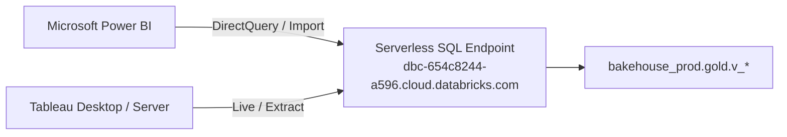

# BI Developers User Guide – Bakehouse Lakehouse

| | |
|---|---|
| **Audience** | Power BI Developers, Tableau Architects, Dashboard Engineers |
| **Endpoint** | Serverless Starter Warehouse (`3c88b7bfb51daab1`) |
| **Catalog / Schema** | `bakehouse_prod.gold` (or `bakehouse_dev.gold`) |
| **Status** | PRODUCTION READY |

---

## 1. SQL Endpoint Connection Details

BI tools (Power BI, Tableau, ThoughtSpot, Qlik, Looker) connect directly to the Databricks Serverless SQL Warehouse via certified connectors.

### Connection Parameters

| Parameter | Configuration Value |
|---|---|
| **Server Hostname** | `dbc-654c8244-a596.cloud.databricks.com` |
| **HTTP Path** | `/sql/1.0/warehouses/3c88b7bfb51daab1` |
| **Port** | `443` |
| **Protocol** | HTTPS (TLS 1.2+ mandatory) |
| **Default Catalog** | `bakehouse_prod` (or `bakehouse_dev` for report authoring) |
| **Default Database / Schema** | `gold` |

---

## 2. Authentication: Service Principal Refresh Identity

For shared production reports (Power BI Service, Tableau Cloud/Server):
1. **Never use personal user credentials** for scheduled dataset refreshes. User accounts expire, rotate passwords, or lose access upon personnel changes.
2. **Use a Dedicated Service Principal:**
   - Client ID: `bakehouse-bi-service-principal`
   - Authentication Type: **OAuth 2.0 Client Credentials (M2M)**
   - Assigned Unity Catalog Group: `consumers` (read-only `SELECT` on `gold.v_*`).

---

## 3. Storage Mode: DirectQuery vs Import

| Mode | Recommendation for Bakehouse | Rationale |
|---|---|---|
| **DirectQuery (Live Connection)** | **RECOMMENDED (Default)** | Leverages Photon vectorized execution and Liquid Clustering on the Serverless SQL Warehouse. Eliminates data duplication into proprietary .pbix/.hyper models. Respects real-time dynamic PII masking per querying user. |
| **Import Mode (Scheduled Extract)** | Use only for disconnected mobile dashboards or offline analysis | Requires daily scheduled extract via Service Principal. Be aware: imported models lose dynamic user-level PII masking (all data in extract will be permanently redacted or unredacted based on the service principal). |

---

## 4. Cloud Fetch Validation for Fast Extracts

If extracting large result sets into BI tools:
- **Cloud Fetch** is enabled by default on Databricks SQL Warehouses.
- Instead of funneling millions of rows through the single coordinator/driver node, Cloud Fetch generates pre-signed S3 download URLs, allowing the BI driver to download compressed Arrow batches in parallel.
- **Firewall Check:** Ensure corporate desktop firewalls allow outbound HTTPS connections to `*.s3.us-east-2.amazonaws.com` on port 443. If blocked, drivers will silently fall back to slow sequential fetch.

---

## 5. Semantic Modeling Guidance Against Views

1. **Model Against Views Only:**
   - Always connect to `v_sales_daily`, `v_customer_sales_summary`, and `v_franchise_performance`.
   - **Never connect to `gold_etl`, `silver`, or `bronze` tables.** Direct table connections violate the security boundary and are blocked by Unity Catalog permissions.
2. **Leverage Pushdown Filtering:**
   - When building dashboard slicers, ensure filters on `business_date_local` and `franchise_id` are applied directly as SQL `WHERE` clauses. The warehouse's Photon engine will perform partition and file skipping using Liquid Clustering.
3. **Star Schema Relationships:**
   - `v_sales_daily` serves as the central Fact table (`business_date_local`, `franchise_id`).
   - `v_franchise_performance` serves as the Franchise Dimension table (`franchise_id`).
   - Join cardinality: Many-to-One (`v_sales_daily.franchise_id` $\rightarrow$ `v_franchise_performance.franchise_id`).
