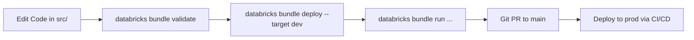

# Data Engineers User Guide – Bakehouse Lakehouse

| | |
|---|---|
| **Audience** | Data Engineers, Analytics Engineers, Platform Developers |
| **Framework** | Declarative Automation Bundles (DABs), Delta Live Tables / Lakeflow Spark Declarative Pipelines |
| **Repository** | `lakehouse_build/` |
| **Status** | PRODUCTION READY |

---

## 1. Repository Layout & Asset Bundles (DABs)

All infrastructure, pipeline DAGs, and transformation code are maintained as code in the repository.

```
lakehouse_build/
├── bundle/
│   ├── databricks.yml                      # Bundle config (dev & prod targets)
│   ├── resources/
│   │   ├── bakehouse_master_orchestration.job.yml # Master Lakeflow DAG
│   │   ├── bakehouse_pipeline.pipeline.yml        # Medallion Declarative Pipeline
│   │   ├── bronze_maintenance.job.yml             # Bronze OPTIMIZE / VACUUM
│   │   ├── silver_maintenance.job.yml             # Silver OPTIMIZE / VACUUM
│   │   └── gold_quality_check.job.yml             # Gold DDL & Quality checks
│   ├── src/
│   │   ├── bronze/bronze_tables.py         # Auto Loader raw ingestion
│   │   ├── silver/silver_tables.py         # Conformed & SCD Type 2 Auto CDC
│   │   ├── gold/gold_etl_tables.py         # Materialized Gold aggregations
│   │   ├── gold/gold_views.sql             # Consumer views & dynamic PII masking
│   │   └── gold/quality_checks.sql         # Atomic business quality rules
│   └── tests/                              # Pytest and end-to-end acceptance suites
├── 01_discovery_scoping/                   # Project scoping & discovery records
├── 02_foundation_kickoff/                  # Compute, keys, and governance specs
├── 03_bronze/                              # Bronze design & validation evidence
├── 04_silver/                              # Silver design & validation evidence
├── 05_gold/                                # Gold design & validation evidence
└── 06_optimization_governance_close/       # Phase 6 Runbook, guides & sign-off
```

---

## 2. Standard DABs Development Workflow



### Essential CLI Commands

```bash
# 1. Validate YAML syntax and bundle variables
cd bundle
databricks bundle validate --profile dev

# 2. Deploy bundle changes to dev target
databricks bundle deploy --profile dev

# 3. Trigger manual pipeline refresh on dev
databricks bundle run bakehouse_pipeline --profile dev

# 4. Trigger master orchestration DAG on dev
databricks bundle run bakehouse_master_orchestration --profile dev
```

---

## 3. Transformation Standards & SCD Type 2 Mechanics

### 3.1 Naming and Type Casting Standards
- **Naming:** All columns in Silver and Gold must follow `snake_case`.
- **Timestamp Conventions:** Standardized suffixes:
  - `_ts`: Timestamps (e.g., `transaction_ts`, `effective_from_ts`).
  - `_date`: Local business dates (e.g., `business_date_local`).
- **Monetary Values:** Never store currency as floating point. Explicitly cast to `DECIMAL(10,2)` or `DECIMAL(12,2)`.
- **Booleans:** Convert `'Y'/'N'` and `'1'/'0'` to explicit `BOOLEAN` (`is_active`, `is_current`).

### 3.2 Customer SCD Type 2 Historization (`dlt.apply_changes`)
Customer dimension changes are historized using Delta Live Tables `AUTO CDC`:
```python
dlt.apply_changes(
    target = "customers_scd2",
    source = "bronze_customers_stream",
    keys = ["customer_id"],
    sequence_by = col("_batch_ts"),
    stored_as_scd_type = 2
)
```
- In Silver, `customers` is a Materialized View querying `customers_scd2 WHERE __is_current = true`, exposing the latest valid state with clean column names (`is_current`, `effective_from_ts`, `effective_to_ts`).

---

## 4. Schema Evolution Protocol

When an upstream source system adds a new column:
1. **Auto Loader Handling:**
   - Auto Loader in `bronze_tables.py` operates with `cloudFiles.schemaEvolutionMode = "addNewColumns"`.
   - New columns land automatically in Bronze without failing the pipeline.
2. **Promoting to Silver:**
   - Do **NOT** rely on automatic schema inference in Silver.
   - Explicitly update `silver_tables.py` with the new column name, explicit `CAST`, and column comment.
   - Run `databricks bundle deploy --profile dev` and run acceptance tests before merging.
3. **Promoting to Gold Views:**
   - Because Gold views use explicit column projections (zero `SELECT *`), views are completely insulated and will not break.
   - If the business requests the new column in Gold, update `gold_etl_tables.py` and `gold_views.sql` with documented descriptions.
