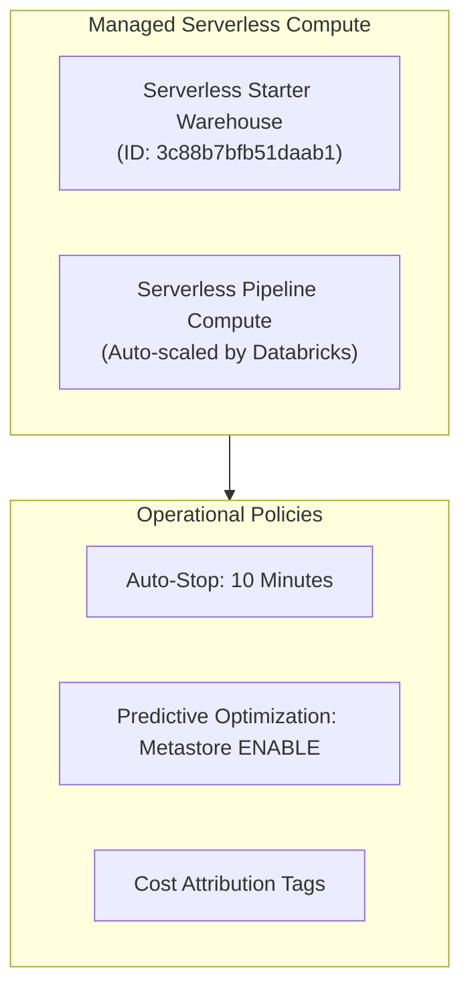

# Platform Operators User Guide – Bakehouse Lakehouse

| | |
|---|---|
| **Audience** | Cloud Platform Administrators, Databricks Workspace Admins, FinOps Leads |
| **Workspace** | `dbc-654c8244-a596.cloud.databricks.com` |
| **Cloud Region** | AWS `us-east-2` |
| **Status** | PRODUCTION READY |

---

## 1. SQL Warehouse & Serverless Compute Administration

The Bakehouse platform relies on Databricks Serverless Compute to minimize idle infrastructure costs and eliminate VM cluster management.



### Warehouse Operational Parameters

| Setting | Production Target | Purpose |
|---|---|---|
| **Warehouse Size** | `2X-Small` (Current) $\rightarrow$ `Small` (at $7.2\times$ scale) | Sized to ensure sub-500ms analytical queries |
| **Auto-Stop** | **10 Minutes** | Shuts down idle instances after 10 minutes of query silence |
| **Min / Max Clusters** | 1 / 1 (Dev) $\rightarrow$ 1 / 3 (Prod Peak) | Scale-out cluster scaling on high user concurrency |
| **Channel** | Current / Preview | Maintained on current LTS channel for latest Photon optimizations |

---

## 2. Lakeflow Jobs Monitoring & Alerting

### Operational Jobs Overview
- **Master Orchestrator Job:** `250613608242315` (`[dev] Bakehouse Master Lakehouse Orchestrator`)
- **Bronze Maintenance Job:** `133956864142235`
- **Silver Maintenance Job:** `472210569540102`
- **Gold Quality Checks Job:** `486220584233115`

### Monitoring Commands via Databricks CLI
```powershell
# List recent runs for the Master Job
databricks jobs list-runs --job-id 250613608242315 --profile dev

# Check run details for a specific run ID
databricks jobs get-run <run_id> --profile dev
```

### Notification Configuration
In production, update `bundle/resources/bakehouse_master_orchestration.job.yml` to route failure notifications to the PagerDuty / Slack operational channel:
```yaml
email_notifications:
  on_failure:
    - data-platform-alerts@bakehouse.com
  no_alert_for_skipped_runs: true
```

---

## 3. Unity Catalog Predictive Optimization

Predictive Optimization runs automated, intelligent table maintenance without user-managed compute:
- **Scope:** Compaction (`OPTIMIZE`), clustering index reorganization, and obsolete snapshot cleanup (`VACUUM`).
- **Status Verification:**
  ```sql
  -- Verify predictive optimization is active on catalogs
  SELECT catalog_name, predictive_optimization
  FROM system.information_schema.catalogs
  WHERE catalog_name IN ('bakehouse_dev', 'bakehouse_prod');
  ```
- **Operational Benefit:** Operates as a Databricks-managed background service. Eliminates the cost of spinning up dedicated cluster nodes to run manual vacuum and compaction jobs.

---

## 4. FinOps & Cost Attribution Tags

Every resource deployed in the Bakehouse platform carries standard governance and cost-allocation tags.

### Standard Tag Hierarchy

| Tag Key | Value(s) | Usage in AWS / Azure / GCP Billing |
|---|---|---|
| `project` | `bakehouse` | Consolidates all Lakehouse spend under the franchise analytics project |
| `environment` | `dev` / `prod` | Distinguishes development and testing spend from production serving |
| `layer` | `master` / `bronze` / `silver` / `gold` | Attributes compute cost to specific pipeline stages |
| `cost_center` | `franchise-analytics-104` | Charges compute directly to the commercial analytics cost center |
| `owner` | `data-engineers` | Identifies responsible operational team |

### Querying Daily DBU Consumption
```sql
SELECT 
    usage_date,
    sku_name,
    usage_metadata.job_id,
    SUM(usage_quantity) AS total_dbus
FROM system.billing.usage
WHERE custom_tags.project = 'bakehouse'
GROUP BY usage_date, sku_name, usage_metadata.job_id
ORDER BY usage_date DESC;
```
