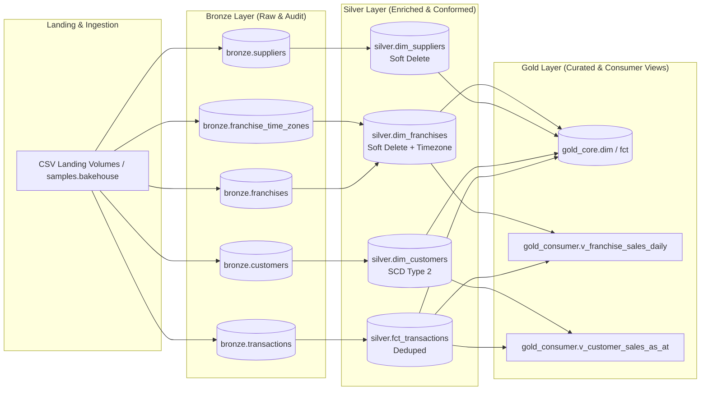

# 🍪 Bakehouse Lakehouse Architecture on Databricks

> End-to-end implementation of an enterprise-grade Lakehouse following the **Medallion Architecture** (Bronze, Silver, Gold), powered by **Databricks**, **Delta Lake**, **Unity Catalog**, and **Declarative Automation Bundles (DABs)**.

---

## 📌 Project Overview

This repository documents and implements a production-grade Lakehouse solution for **Bakehouse** (a global cookie franchise), spanning discovery, governance, dimensional data modeling, automated pipeline orchestration, and business intelligence consumption.

Built adhering to modern Databricks engineering best practices:
- **Medallion Pattern Separation:** 
  - **Bronze:** Raw, append-only ingestion with audit metadata (`_ingested_at`).
  - **Silver:** Cleaned, validated, deduplicated, and conformed entities with **SCD Type 2** for customer history and soft-delete semantics for franchises and suppliers.
  - **Gold:** Star schema dimension/fact tables (`gold_core`) and consumer-facing curated views (`gold_consumer`).
- **Unity Catalog & Enterprise Governance:** Granular Role-Based Access Control (RBAC), PII data masking, isolation across schemas, and full lineage tracking.
- **Delta Lake Optimization:** Liquid Clustering, Auto-Compaction, automated `OPTIMIZE` and `VACUUM` policies, and Bloom filter indexes for low-latency queries.
- **Declarative Automation & CI/CD:** End-to-end master DAG orchestration powered by Databricks Asset Bundles (DABs) and Lakeflow Jobs.

---

## 🏛️ Solution Architecture



---

## 📂 Repository Structure

```text
├── 01_discovery_scoping/               # Scope definition, persona matrix, and architectural boundaries
├── 02_foundation_kickoff/              # Compute sizing, keys, temporal design, and governance guardrails
├── 03_bronze/                          # Ingestion DDLs, volume configurations, and Bronze test suites
├── 04_silver/                          # Silver transformation logic, SCD Type 2 merge, and quality gates
├── 05_gold/                            # Star schema modeling, consumer reporting views, and data masks
├── 06_optimization_governance_close/   # Runbooks, Delta tuning, acceptance test reports, and sign-offs
├── bundle/                             # Databricks Asset Bundle (DABs) resources and target configurations
├── implementation_plan.md              # Phase-by-phase implementation tracking & milestone plan
└── LICENSE                             # MIT License
```

---

## 🛠️ Technology Stack

- **Platform:** Databricks (Serverless Compute, DBSQL Serverless Warehouses)
- **Engine & Storage:** Apache Spark & Delta Lake
- **Governance:** Unity Catalog (RBAC, Dynamic Column Masks, Row Filters, Lineage)
- **Orchestration & DevOps:** Databricks Asset Bundles (DABs), Lakeflow Jobs
- **Languages:** SQL (Databricks SQL / DBSQL), Python (PySpark)

---

## 🚀 Deployment & Execution

### Prerequisites
- Databricks CLI v0.200+ / v1.x configured (`databricks auth login`)
- Target Databricks Workspace with Unity Catalog enabled

### Build and Deploy via DABs
```bash
# Validate bundle configuration
databricks bundle validate

# Deploy bundle to development target
databricks bundle deploy -t dev

# Run end-to-end orchestration job
databricks bundle run bakehouse_pipeline -t dev
```

---

## 👥 Personas & Operating Guides

Comprehensive operating procedures and playbooks are located in [`06_optimization_governance_close/user_guides/`](06_optimization_governance_close/user_guides/):
- **Data Analysts:** [`01_analysts_guide.md`](06_optimization_governance_close/user_guides/01_analysts_guide.md)
- **BI & Dashboard Developers:** [`02_bi_developers_guide.md`](06_optimization_governance_close/user_guides/02_bi_developers_guide.md)
- **Data Engineers:** [`03_data_engineers_guide.md`](06_optimization_governance_close/user_guides/03_data_engineers_guide.md)
- **Platform Operators & SREs:** [`04_platform_operators_guide.md`](06_optimization_governance_close/user_guides/04_platform_operators_guide.md)

---

## 📄 License

This project is licensed under the [MIT License](LICENSE).
