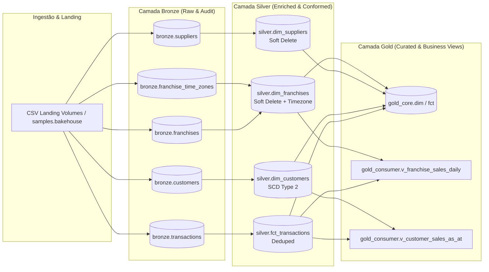

# 🍪 Bakehouse Lakehouse Architecture on Databricks

> End-to-end implementation of an enterprise-grade Lakehouse following the **Medallion Architecture** (Bronze, Silver, Gold), powered by **Databricks**, **Delta Lake**, **Unity Catalog**, and **Declarative Automation Bundles (DABs)**.

---

## 📌 Visão Geral do Projeto

Este repositório documenta e implementa a construção completa do Lakehouse para a **Bakehouse** (uma franquia global de cookies), abrangendo desde o discovery, governança e modelagem de dados até orquestração de pipelines e consumo analítico.

O projeto foi desenhado sob as melhores práticas recomendadas de engenharia de dados da Databricks:
- **Separação de Camadas (Medallion Pattern):** Bronze (raw/auditável), Silver (limpa, deduplicada, enriquecida e historizada) e Gold (modelagem dimensional e agregados de negócio).
- **Unity Catalog & Governança:** Controle de acesso granular baseado em perfis (RBAC), anonimização/mascaramento de dados sensíveis (PII) e isolamento de catálogo.
- **Historização Avançada:** Implementação de **SCD Tipo 2** (Slowly Changing Dimensions) e padrões de *Soft Delete* para rastreabilidade temporal.
- **Otimização de Performance:** Uso de *Liquid Clustering*, *Auto-Compaction*, *OPTIMIZE* e particionamento inteligente com Delta Lake.
- **Orquestração e CI/CD:** Master DAG de orquestração via Lakeflow Jobs / Databricks Asset Bundles (DABs).

---

## 🏛️ Arquitetura da Solução



---

## 📂 Estrutura do Repositório

```text
├── 01_discovery_scoping/               # Documentação de escopo, personas e matriz de requisitos
├── 02_foundation_kickoff/              # Planejamento de compute, chaves, tempo e guardrails
├── 03_bronze/                          # Pipelines de ingestão Bronze, metadados e DDLs
├── 04_silver/                          # Transformações Silver, SCD Tipo 2, soft-delete e testes
├── 05_gold/                            # Modelagem dimensional Gold, consumer views e segurança
├── 06_optimization_governance_close/   # Runbooks, otimizações Delta, guias de usuário e sign-off
├── bundle/                             # Configurações do Databricks Asset Bundle (DABs)
├── implementation_plan.md              # Plano de implementação detalhado por fases
└── LICENSE                             # Licença MIT
```

---

## 🛠️ Tecnologias Utilizadas

- **Plataforma:** Databricks (Serverless Compute / SQL Warehouses)
- **Engine & Formato:** Apache Spark & Delta Lake
- **Governança:** Unity Catalog (RBAC, Data Masking, Lineage)
- **Orquestração & Infra:** Databricks Asset Bundles (DABs), Lakeflow Jobs
- **Linguagens:** SQL (Databricks DBSQL), Python (PySpark)

---

## 🚀 Como Executar o Projeto

### Pré-requisitos
- Databricks CLI configurado (`databricks auth login`)
- Acesso a um workspace Databricks com Unity Catalog habilitado

### Validação e Deploy com DABs
```bash
# Validar configurações do bundle
databricks bundle validate

# Fazer o deploy para ambiente de desenvolvimento
databricks bundle deploy -t dev

# Executar a pipeline principal
databricks bundle run bakehouse_pipeline -t dev
```

---

## 👥 Persona & Guias de Uso

Documentação dedicada e runbooks operacionais disponíveis na pasta [`06_optimization_governance_close/user_guides/`](06_optimization_governance_close/user_guides/):
- **Analistas:** [`01_analysts_guide.md`](06_optimization_governance_close/user_guides/01_analysts_guide.md)
- **Desenvolvedores BI:** [`02_bi_developers_guide.md`](06_optimization_governance_close/user_guides/02_bi_developers_guide.md)
- **Engenheiros de Dados:** [`03_data_engineers_guide.md`](06_optimization_governance_close/user_guides/03_data_engineers_guide.md)
- **Operações & Plataforma:** [`04_platform_operators_guide.md`](06_optimization_governance_close/user_guides/04_platform_operators_guide.md)

---

## 📄 Licença

Este projeto está sob a licença [MIT](LICENSE).
