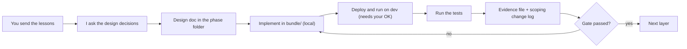

# Implementation Plan – Phases 3 to 6 (Bronze, Silver, Gold, Optimization/Governance/Close)

| | |
|---|---|
| **Status** | PROPOSED – awaiting your approval. Nothing in this plan has been executed |
| **Written** | 2026-10-24 |
| **Builds on** | Phase 1 ([scoping_document.md](01_discovery_scoping/scoping_document.md)) and Phase 2 ([02_foundation_kickoff](02_foundation_kickoff/)) |
| **How we work** | You send the lessons for one layer at a time. I read them, ask the design questions, write the design doc, implement, and show evidence. See §3 |

> The first lessons of the Bronze layer (schema and ingestion patterns, metadata and maintenance) are already received. The plan for Bronze is therefore detailed. Silver, Gold and Close are outlined from the course descriptions and will be refined when their lessons arrive.

---

## 1. Where we are

| Phase | Status |
|---|---|
| 1 Discovery & Scoping | Docs drafted, not signed off. VERIFY items open |
| 2 Foundation & Kickoff | 3 lessons documented (compute, keys/time, governance). **No platform objects created yet.** Checks waiting for you |
| 3 to 6 | Not started |

### Local tooling found on this machine (read-only checks)

| Tool | State |
|---|---|
| Databricks CLI | **v1.13.0 installed** |
| CLI authentication | **Profiles `DEFAULT` and `dev` exist but both are INVALID** (host `dbc-654c8244-a596.cloud.databricks.com`, so the workspace is on AWS) |
| `databricks aitools` | Available. Supports Antigravity (raw skill files), sourced from [github.com/databricks/databricks-agent-skills](https://github.com/databricks/databricks-agent-skills) |
| uv, git, node | Installed |
| python | The path points into `WindowsApps` and may be the Store stub. VERIFY. `uv` can supply a real one |

---

## 2. Phase 2 completion: the practical foundation (Step 0)

Phase 2 was documentation only. Phase 3 can't start until the workspace is ready to receive Bronze, which is the Phase 2 exit rule. These steps **change your workspace**, so each one waits for your explicit go-ahead.

| # | Step | Needs from you |
|---|---|---|
| 0.1 | **Authenticate the CLI** with `databricks auth login` (opens a browser) and confirm with `databricks auth profiles` | You complete the browser login |
| 0.2 | **Tools and skills**: install the official Databricks agent skills (see §5) | Decision on scope |
| 0.3 | **Run the workspace checks**: region, quota, `samples.bakehouse`, groups, catalog creation, managed volume, masks, `bundle validate`, service principal option ([01_architecture_compute_planning.md](02_foundation_kickoff/01_architecture_compute_planning.md) §2, [03_governance_guardrails.md](02_foundation_kickoff/03_governance_guardrails.md) §8). I can run read-only ones through the CLI once authenticated | Approval to run them |
| 0.4 | **Run the key checks (K-T1)** on `samples.bakehouse` and check the `dateTime` type. Replaces the VERIFY estimates in the Phase 1 docs | Approval |
| 0.5 | **Create the bundle skeleton** (`bundle/` with `databricks.yml`, `dev` and `prod` targets). Local files only | Approval |
| 0.6 | **Create groups, catalogs and the landing volume**, as far as Free Edition allows (D-S3, D-S5) | Approval for each |
| 0.7 | **Assemble the foundation readiness record** and close Phase 2 | Review |

**Gate G0:** all F-T and S-T tests that can run now are green, and every Free Edition deviation is written down.

---

## 3. Working method for every layer



| Rule | Detail |
|---|---|
| Design before code | Each layer starts with the same pattern as Phases 1 and 2: questions first, then the document. I explain every decision I make without asking |
| No surprise changes to your workspace | Deploying, creating objects, running pipelines, and anything that uses the quota need your OK |
| Traceability | Every design doc links to the scoping document. If a decision contradicts it, the change log is updated explicitly (CL-n) |
| Tests are the evidence | Every acceptance test has an ID and a result recorded under an `evidence/` folder in the phase folder |
| Dev first | Everything runs on `bakehouse_dev` before `bakehouse_prod` |

### Folder plan (nothing below exists yet)

```
lakehouse_build/
├── implementation_plan.md
├── 01_discovery_scoping/            done (draft)
├── 02_foundation_kickoff/           3 lessons documented
├── 03_bronze/                       design docs + evidence/
├── 04_silver/                       design docs + evidence/
├── 05_gold/                         design docs + evidence/
├── 06_optimization_governance_close/  design docs, runbook, guides, cost summary, evidence/
└── bundle/                          all deployable code (see 03_governance_guardrails.md §6)
```

---

## 4. Layer plans

### Phase 3 – Land & Solidify Bronze (lessons received: 2 of 2)

**Goal:** a governed Bronze schema holding the five sources as landed, with lineage metadata, validated and maintained.

| # | Step | Result |
|---|---|---|
| 3.1 | **Export script** from `samples.bakehouse` to CSV files in the landing volume. Transactions: an initial snapshot up to the 80th percentile of transaction time (as the lesson does), then the remaining 20% as production-sized incremental batches. Dimensions: daily full files with the synthetic changes from the change plan. Plus the time zone seed. ISO 8601 UTC, file names `<source>_<yyyymmddHH>.csv` | Landed files and a change log |
| 3.2 | **Create the Bronze schema** (`bronze`, per D-S5) with owner, comment and the `owner`, `layer`, `project` tags at creation | Schema in UC |
| 3.3 | **Choose and build the ingestion tool per source** (see decisions below) | Bronze tables loaded |
| 3.4 | **Snapshot then incremental replay**: load the snapshot, replay batches in arrival order, prove that a re-run adds nothing | Counts match the source |
| 3.5 | **Metadata columns** on every row: `_ingested_at`, `_batch_ts`, `_source_file`, `_source_system`, `_schema_version` | See reconciliation below |
| 3.6 | **Validation suite**: distinct keys, time ranges, row counts, file counts, file size distribution | Tests green |
| 3.7 | **Maintenance**: `OPTIMIZE`, `ANALYZE TABLE ... COMPUTE STATISTICS`, `VACUUM` with the agreed retention, and a check on Predictive Optimization | Jobs defined |
| 3.8 | **Bronze acceptance** against the lesson's checklist, and the design doc | Gate G3 |

**Decisions I will ask you when we start Bronze**
1. Ingestion tool per source: Auto Loader streaming tables inside the pipeline (my likely recommendation, since all five sources are files with exactly-once discovery), versus `read_files` with INSERT, versus `COPY INTO`.
2. Batch granularity of the POS replay (hourly versus daily), once the real time range is known.
3. Layout owner per Bronze table (see below).

**Things the lessons change or leave open (I will handle them, not ask)**

| Topic | What I will do |
|---|---|
| **High-water-mark pattern** | **Not applicable.** It needs an `update_ts` and no source has one (lesson 4 of Phase 1). I will document it as considered and rejected |
| **Schema name** | The lesson's example is `{catalog}.bakehouse_bronze`. Ours is `bakehouse_<env>.bronze` (CL-3). The lesson's naming rule (no layer prefix on tables) still holds. Logged as a deviation |
| **Managed location** | The lesson uses an external location. Free Edition doesn't offer one, so Bronze uses catalog managed storage (already recorded as a deviation) |
| **Metadata columns** | The lessons name `_ingested_at`, `_source_file`, `_source_system`, `_schema_version`. Phase 2 added `_batch_ts`. The union of both lists is used, logged as CL-5 |
| **Layout owner** | Bronze gets plain scheduled `OPTIMIZE`, because no layout decision exists yet and compaction composes with a later strategy. If Silver adopts Liquid Clustering or Z-ORDER, Bronze does not need to change |
| **Small files** | Our design is one file per interval, so the check passes. I will also run a documented bad-case sample to prove the check can fail |
| **Data size** | Tables are tiny, so `OPTIMIZE` effects can't be measured here. Measured benefits move to the scaled load test in Phase 6 |

**Tests:** K-T1, K-T2, K-T8, K-T9, H-T6, S-T4, S-T6, plus new provisional tests B-T1 to B-T6 (metadata populated, comments and tags present, re-run is idempotent, file counts match, size distribution within bounds, maintenance scheduled).

**Risks:** the quota (R1), CLI authentication, Auto Loader behaviour on Free Edition (VERIFY), Predictive Optimization availability (VERIFY).

---

### Phase 4 – Land & Solidify Silver (lessons: to come)

**Goal:** cleansed, conformed, historized tables that consumers can trust.

| # | Step | Traces to |
|---|---|---|
| 4.1 | Column mapping and data dictionary (source name → snake_case), explicit type conversions and timestamp parsing | D-K4, K-T6 |
| 4.2 | Transactions: dedupe on `transaction_id`, drop or tokenize the card number | K-T3, G-T4 |
| 4.3 | Customers: **Type 2** from daily snapshots with the AUTO CDC APIs, with Delta `MERGE` as the comparison (the course covers both) | H-T1 to H-T3, K-T4, K-T5, K-T10 |
| 4.4 | Suppliers and franchises: soft delete, current state, time zone attached to franchises | H-T4 |
| 4.5 | Tags on columns, comments, ownership | S-T1, S-T4 |
| 4.6 | Physical layout tuned to the read patterns profiled in lesson 2 of Phase 1 (one layout owner per table) | Phase 1 filter and join columns |
| 4.7 | Silver acceptance and design doc | Gate G4 |

**Open until the lessons arrive:** AUTO CDC versus `MERGE` as the primary, which customer columns trigger a new version, and the layout mechanism.

---

### Phase 5 – Develop Gold Layer (lessons: to come)

**Goal:** a stable, governed contract surface for the three personas.

| # | Step | Traces to |
|---|---|---|
| 5.1 | Separate engineering tables from consumer views | D-S1 |
| 5.2 | Three outputs: sales by franchise and day, customer sales with as-at attributes, franchise-to-supplier | Scoping §1 |
| 5.3 | Local business dates via the time zone seed | K-T7 |
| 5.4 | Business rule quality checks | D2 |
| 5.5 | Predicate pushdown and query optimization on the profiled filters | Phase 1 profiling |
| 5.6 | Role-based access at the view level, masked customer-detail view, `pii-readers` | S-T5, G-T1 |
| 5.7 | Gold acceptance and design doc | Gate G5 |

**Open until the lessons arrive:** masking mechanism (depends on workspace check 4), SLA verification method.

---

### Phase 6 – Optimization, Governance & Close (lessons: to come)

| # | Step | Free Edition note |
|---|---|---|
| 6.1 | Scale and load-test ingestion at 7.2x (stress case 14x) using scaled replicas of the data | Volumes remain small, and the quota limits repeats |
| 6.2 | Delta performance best practices, with measured before and after | |
| 6.3 | Governance across environments (dev → prod). **Across workspaces is not possible** with one workspace, so it is documented | Deviation |
| 6.4 | Serving layer for BI: SQL warehouse and a dashboard for the operations persona | One small warehouse |
| 6.5 | Automation with Lakeflow Jobs and bundles (`dev` and `prod` targets) | Event-driven runs (D-A3) |
| 6.6 | Runbook, per-persona guides, erasure procedure test | |
| 6.7 | Evidence pack: test results, measured performance, **cost summary**, sign-off | Cost is quota use, not currency |

---

## 5. Databricks tools and skills

### Official agent skills (your request)

| Item | Detail |
|---|---|
| Source | [github.com/databricks/databricks-agent-skills](https://github.com/databricks/databricks-agent-skills), installed through `databricks aitools` |
| Antigravity | Supported. It receives **raw skill files** (`SKILL.md`), not a plugin |
| Covers | Per the CLI help: bundles, jobs, SQL, "and more". I'll confirm the exact skills after preview |
| Proposed approach | 1) **Preview** into a scratch folder with `databricks aitools install --path <dir>` (no agent, no state). 2) Review the list. 3) Install for Antigravity |
| Scope choice | **Project** (kept with this repo) or **global** (available to every project). See the question in §7 |
| Maintenance | `databricks aitools list` and `update` |

### Tool inventory

| Tool | Used for | Phase | State |
|---|---|---|---|
| Databricks CLI | Auth, bundles, jobs, pipelines, volumes, catalogs, `aitools` | All | Installed, **auth invalid** |
| Declarative Automation Bundles | Deployment of pipelines, jobs, warehouse, targets | 0.5, all | Needs `bundle validate` check |
| Unity Catalog (catalogs, schemas, volumes, tags, masks, grants) | Governance | All | Workspace checks pending |
| Lakeflow Spark Declarative Pipelines (streaming tables, AUTO CDC) | The medallion pipeline | 3, 4, 5 | VERIFY on Free Edition |
| Lakeflow Jobs | Orchestration, maintenance, validation runs | 3, 6 | VERIFY |
| Serverless notebooks and SQL warehouse | Export, validation, ad-hoc queries | 3 to 6 | VERIFY |
| AI/BI dashboards | Serving layer for the operations persona | 6 | VERIFY |
| Python tooling (`uv`, `pytest`, Databricks SDK for Python) | Scripts and tests | 3 to 6 | uv installed. Others to add when needed |
| Git | Version control, change history | All | Installed. The folder may not be a repo yet (VERIFY) |

I will add only the tools that a step actually needs, and tell you when I do.

---

## 6. Test and gate map

| Gate | When | Tests that must pass |
|---|---|---|
| **G0** Foundation | End of Step 0 | F-T1 to F-T3, S-T1 to S-T3, S-T7, K-T1 |
| **G3** Bronze | End of Phase 3 | K-T2, K-T8, K-T9, H-T6, S-T4, S-T6, B-T1 to B-T6 |
| **G4** Silver | End of Phase 4 | K-T3 to K-T6, K-T10, H-T1 to H-T5, G-T4 |
| **G5** Gold | End of Phase 5 | K-T7, S-T5, G-T1, G-T2 |
| **G6** Close | End of Phase 6 | D1 to D6, F-T4, G-T3, G-T5, S-T7 and stakeholder sign-off |

## 7. Questions for you

1. **Skills install scope:** project (inside this repo) or global? I recommend **project**, after a preview into a scratch folder, so the skills used by this build are versioned with it.
2. **Authentication:** both CLI profiles are invalid. Are you able to run `databricks auth login` for the `dev` profile (it needs your browser)? I can start it, but you have to complete the login.
3. **Order:** do you approve starting with Step 0, then Phase 3 (Bronze) using the two Bronze lessons you already sent?
4. **Git:** should I initialise a Git repository in this folder so each phase is a commit?

---

## 8. Progress log

| Date | Step | Result |
|---|---|---|
| 2026-10-24 | Plan approved | You answered yes to all four questions in §7 |
| 2026-10-24 | 0.1 CLI login | `databricks auth login --profile dev` started. Waiting for you to complete the browser login |
| 2026-10-24 | Git | Repository initialised on branch `main`, with a `.gitignore` that excludes `.databricks/`, `.env` and token files |
| 2026-10-24 | 0.2 Skills | **13 official skills installed into the project** at `.agents/skills/`, from `databricks-agent-skills` v0.2.10 (see below) |

### Skills installed (project scope)

The CLI refuses project scope for Antigravity (`Antigravity: does not support project-scoped skills`). Antigravity does discover skills in `.agents/skills/` at the repo root, so I wrote them there with `--path` instead. They are versioned with the project. The drawback is that this install keeps no state, so `databricks aitools update` can't track it. To update, re-run the same command.

| Skill | Used for |
|---|---|
| `databricks-core` | Entry point: CLI, authentication, profiles, bundles |
| `databricks-dabs` | Declarative Automation Bundles (targets, resources, deploy) |
| `databricks-pipelines` | Lakeflow Spark Declarative Pipelines (Bronze, Silver, Gold, AUTO CDC) |
| `databricks-jobs` | Lakeflow Jobs (maintenance, validation, scheduling) |
| `databricks-unity-catalog` | Grants, ownership, masks, volumes, tags, system tables |
| `databricks-dbsql` | SQL warehouse and SQL patterns |
| `databricks-aibi-dashboards` | Serving layer dashboard (Phase 6) |
| `databricks-python-sdk` | SDK and Databricks Connect for scripts and tests |
| `databricks-data-discovery` | Exploring `samples.bakehouse` and profiling |
| `databricks-execution-compute` | Running code on serverless and managing the warehouse |
| `databricks-docs` | Documentation lookup |
| `databricks-synthetic-data-gen` | Scaled replicas for load tests (Phase 6) |
| `databricks-spark-structured-streaming` | Streaming and Auto Loader reference |

Not installed (not needed for this build): agent bricks, AI functions, apps, Iceberg, Lakebase, Lakeflow Connect, ML and model serving, vector search, Zerobus, serverless migration, PDF generation, metric views, and 3 experimental skills. Any of them can be added later.
